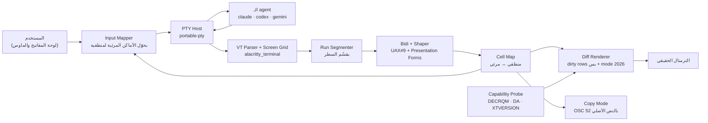
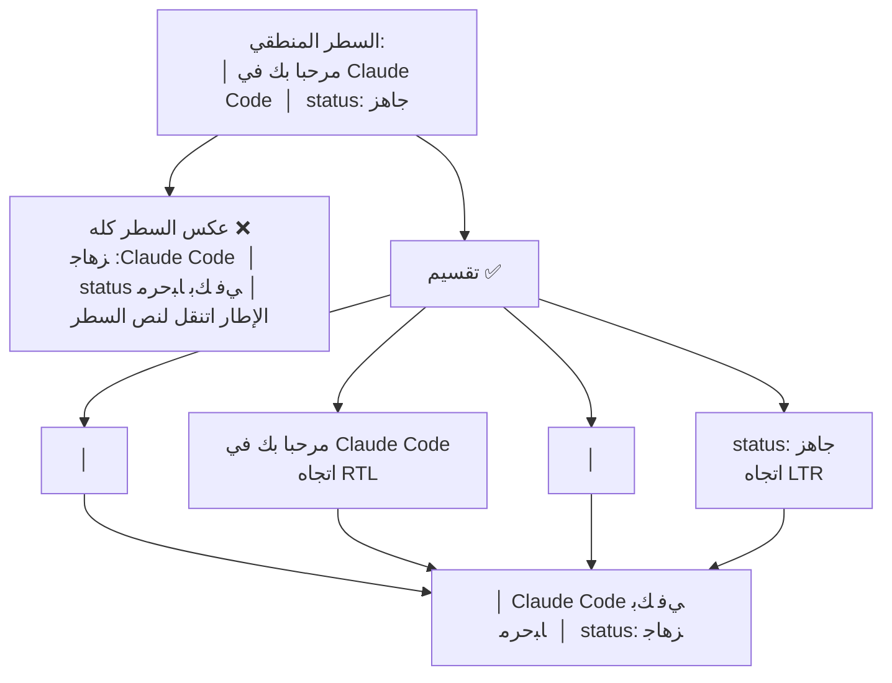
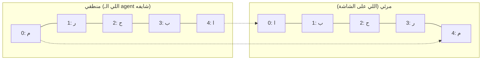

# المعمارية: طبقة RTL على مستوى الـ pty

> اسم المشروع **مرآة (`mirah`)**. الاسم المبدئي `ar` اتلغى لأنه بيتعارض مع برنامج الأرشفة `ar` اللي في binutils.

## الصورة الكبيرة



**الفكرة الأساسية:** الأداة بتعمل نسختين من الشاشة. النسخة **المنطقية** هي اللي الـ agent كتبها بالظبط، وكل التعامل مع البرنامج بيبقى عليها: المؤشر والماوس والنسخ. النسخة **المرئية** هي اللي بتترسم على الترمنال. الـ Cell Map بيربط كل خلية في النسختين ببعض.

## المكونات

| المكوّن | المسؤولية | المكتبة | ملاحظات |
|---|---|---|---|
| PTY Host | يشغّل البرنامج، ويوصّل SIGWINCH والـ resize، ويرجّع الـ exit code | `portable-pty` | ConPTY على Windows في مرحلة متأخرة |
| VT Parser + Grid | يفهم CUP وEL وED وDECSTBM وSGR وalt screen 1049 وغيرهم | `alacritty_terminal` | أكمل من `vt100` في scroll regions والـ alt screen |
| Capability Probe | يعرف الترمنال: بيدعم BDSM؟ بيعمل shaping؟ بيدعم mode 2026؟ | نكتبه بنفسنا | لو مفيش رد في 100ms نفترض الحالة الأضعف |
| Run Segmenter | يقسّم السطر لأجزاء مستقلة | نكتبه بنفسنا | قلب الأداة، والتفاصيل تحت |
| Bidi + Shaper | UAX#9 لكل جزء، وتوصيل الحروف بـ Presentation Forms-B | `unicode-bidi` + shaper بنكتبه | لازم "لا" تبقى ligature والعرض يتظبط بالحشو |
| Cell Map | جدول بيربط مكان كل خلية في النسخة المنطقية بمكانها في المرئية، ويتحسب من جديد مع كل سطر بيتغير | نكتبه بنفسنا | بيستخدمه المؤشر والماوس والنسخ |
| Diff Renderer | يرسم السطور اللي اتغيرت بس، جوه synchronized output | نكتبه بنفسنا | لازم ميزوّدش latency ملحوظة |
| Input Mapper | يمرر لوحة المفاتيح زي ما هي، ويعكس أماكن الماوس من مرئي لمنطقي | نكتبه بنفسنا | bracketed paste والـ kitty keyboard بيعدّوا زي ما هم |
| Copy Mode | اختيار نص بالكيبورد زي tmux، والنسخ بـ OSC 52 بالنص الأصلي | نكتبه بنفسنا | علشان الـ selection العادي في الترمنال بيطلّع حروف Presentation Forms |

## ليه السطر لازم يتقسّم (درس الـ spike)



**قواعد التقسيم:**

1. **حروف رسم الإطارات** (U+2500 لـ U+257F) بتفصل بين الأجزاء ومكانها مابيتغيرش.
2. **مسافتين أو أكتر ورا بعض** بيفصلوا بين الأعمدة.
3. **تغيير في الخلفية أو الـ inverse** معناه عنصر واجهة مختلف، فبيفصل هو كمان.
4. **اتجاه كل جزء** بيتحدد من أول حرف قوي فيه (قاعدتي P2 وP3).
5. **لو الجزء مفيهوش ولا حرف RTL** بيعدّي زي ما هو من غير أي حساب، وده أغلب الشاشة.
6. **عرض الجزء بيفضل ثابت:** لو "لا" قصّرت الجزء خلية، بنحشي مسافة عشان باقي السطر مايتحركش.

## بدء التشغيل والتفاوض مع الترمنال

```mermaid
sequenceDiagram
  participant T as الترمنال الحقيقي
  participant W as الأداة
  participant A as الـ agent
  W->>T: CSI ? 8 $ p (هل بتدعم BDSM؟)
  alt الرد 8;1 أو 8;2
    W->>T: CSI 8 l (اقفل الـ bidi بتاعك)
    Note over W: وضع explicit: الأداة بترتّب بنفسها
  else مفيش رد والترمنال من غير bidi
    Note over W: نفس الوضع، ومفيش داعي نقفل حاجة
  else ترمنال بيعمل bidi ومش بيدعم BDSM (Konsole)
    W->>T: تحذير، والأداة تشتغل passthrough
  end
  W->>A: spawn مع CLAUDE_CODE_DISABLE_ALTERNATE_SCREEN=1 لو اتطلب
  loop كل frame
    A->>W: VT bytes
    W->>T: الصفوف اللي اتغيرت بعد الترتيب، جوه mode 2026
  end
  W->>T: CSI 8 h عند الخروج أو Ctrl-Z
```

## المؤشر والماوس



- **المؤشر:** الـ agent بيحط المؤشر في عمود منطقي، والأداة بتحوّله لعمود مرئي عن طريق الـ Cell Map. لو المؤشر في آخر جزء RTL، بيظهر على **شماله**.
- **الماوس:** كليك على عمود مرئي بيتحوّل لعمود منطقي قبل ما يوصل للـ agent.
- **حدود v1:** التعديل في نص الكلام المختلط بيشتغل، بس الأسهم بتتحرك بالترتيب المنطقي. ده نفس اللي بيعمله Windows Terminal وVTE.

## اختيار التقنية

| المعيار | **Rust** ✅ | Go | Node / Bun |
|---|---|---|---|
| binary واحد من غير runtime | ✅ | ✅ | ❌ محتاج Node + native addon |
| مكتبة VT جاهزة وكاملة | ✅ alacritty_terminal | ⚠️ ضعيفة | ✅ @xterm/headless |
| مكتبة bidi كاملة | ✅ unicode-bidi | ❌ x/text/bidi ناقصة | ✅ bidi-js |
| latency وذاكرة | ✅ | ✅ | ⚠️ |
| Windows ConPTY | ✅ portable-pty | ✅ | ✅ node-pty |
| بيميّزنا عن agent-rtl | ✅ | ✅ | ❌ نفس الـ stack بتاعها |

**التوصية: Rust.** الـ stack الافتراضي (Bun/Hono) معمول للويب، والأداة دي terminal native. Rust هي اللغة الوحيدة اللي بتجمع binary واحد ومكتبة VT ناضجة ومكتبة bidi كاملة، وده كمان اللي يميّزها عن `agent-rtl` المبنية على Node.

> القرار الكامل والبدائل في `Plan/ADR/0001-Stack.md`.

## المخاطر التقنية بالترتيب

| # | الخطر | الحل | الخطورة |
|---|---|---|---|
| 1 | الترمنال يعكس النص تاني فوق ترتيبنا | نتفاوض على BDSM، ونعمل allowlist، ونحذّر في الباقي | عالية |
| 2 | تقسيم السطر يغلط في واجهة جديدة | قواعد تقسيم، وcorpus من screenshots حقيقية، وطريقة لتعطيل جزء بعينه | عالية |
| 3 | المؤشر والتعديل في خانة الكتابة | Cell Map، وv1 بيقبل إن الأسهم تتحرك بالترتيب المنطقي | عالية |
| 4 | النسخ بيطلّع presentation forms | Copy mode + OSC 52 | عالية |
| 5 | "لا" بتغيّر عدد الخلايا | نحشي مسافة عشان العرض يفضل ثابت | متوسطة |
| 6 | التطبيقات اللي بتستخدم alt screen والماوس | نشغّل Claude Code في الوضع الكلاسيكي ونعكس أماكن الماوس | متوسطة |
| 7 | الخط مفيهوش Presentation Forms | نوصي بخطوط معينة، والـ `doctor` يكشف المشكلة | متوسطة |
| 8 | الـ scrollback في الوضع inline | نحتفظ بـ scrollback بتاعنا، أو نشغّل alt screen بس | متوسطة |
| 9 | Windows ConPTY بيغيّر الـ output | برا نطاق v1 | متوسطة |

## برا نطاق v1

- Windows / ConPTY.
- تحريك الأسهم بالترتيب المرئي.
- الـ selection العادي بالماوس للنص العربي (البديل copy mode).
- الترمنالات اللي بتعمل bidi ومش بتدعم BDSM (زي Konsole): الأداة هتحذّر وتشتغل passthrough.
- أي تعديل خاص لـ agent معين غير الـ env flags.
