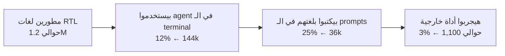

# بحث السوق: طبقة RTL للـ terminal

> تاريخ البحث: 2026-11-05 · نوع البحث: Secondary بس (لسه مفيش مقابلات مع مستخدمين)
> الأرقام اللي مكتوب جنبها "تقدير" محسوبة مني ومش منقولة من مصدر.

## الخلاصة

**القرار: Adjust (نكمّل بس بتعديل في الاتجاه).**

- **الوجع حقيقي ومتكرر:** في 188 issue عن RTL في ريبو Claude Code لوحده، وبلاغات جديدة كل أسبوع (آخرها 2026-11-04).
- **الفكرة نفسها مش جديدة:** في 2026-10-30 ظهرت أداة اسمها `agent-rtl` بنفس الفكرة، وهي pty wrapper مبني على Node. عليها نجمة واحدة و6 commits، وعيوبها مكتوبة في الـ README بتاعها: المؤشر، المحاذاة، "لا"، والماوس.
- **السوق صغير:** تقديري للسنة الأولى حوالي 1,000 مستخدم، ممكن ينزل لـ 160 أو يطلع لـ 7,200. ده كويس لمشروع open source بيبني سمعة، بس مش سوق يتعمل منه بيزنس.
- **ميزة الأداة المحتملة:** binary واحد native، بيحسب مكان المؤشر صح، وفيه copy mode بيرجّع النص الأصلي، وبيتفاوض على BDSM مع الترمنال، ومعاه corpus اختبارات وجدول توافق مفتوح للمجتمع. ولا أداة موجودة بتعمل الحاجات دي مع بعض.

## الملاحظة الأصلية

مطورين بيكتبوا عربي أو عبري أو فارسي جوه agents شغالة في الـ terminal، والنص بيظهر معكوس أو حروفه مفصولة. الحلول الموجودة كلها لأداة واحدة أو لترمنال واحد.

## الافتراضات والدليل

| # | الافتراض | الدليل | الحالة |
|---|---|---|---|
| 1 | المشكلة حقيقية ومتكررة | 188 issue في claude-code (29 مفتوحة)، و52 في codex، و52 في opencode | ✅ متأكد |
| 2 | الشركات مش هتحلّها قريب | Google: "no immediate plans" (gemini-cli#25478، مايو 2026). OpenAI: مفيش رد على codex#34871. Anthropic: صلّحت Windows Terminal بس في 2.1.74، وفي regression اتعمله report بعدها | ✅ متأكد، بس الوضع ممكن يتغير |
| 3 | معظم الوجع جوه الـ terminal | أعلى issue (122 reaction) عن Claude Desktop مش الـ CLI. أعلى issue خاصة بالـ TUI عليها 37 reaction بس | ⚠️ الطلب الأكبر في الواجهات الرسومية |
| 4 | مفيش أداة عامة على مستوى الـ pty | `agent-rtl` موجودة من أسبوع وتجريبية. BiCon قديمة ومعمولة لبرامج بتكتب سطور عادية | ❌ الافتراض اتكسر جزئياً |
| 5 | الحل الشامل ممكن تقنياً | الـ spike نجح في الإطارات والنص المختلط | ✅ في الحالات البسيطة |
| 6 | المستخدمين مستعدين يشغّلوا wrapper | VS Code extension واحدة عدّت 10.5k تثبيت. الأدوات الخاصة بالـ terminal تقريباً محدش بيستخدمها | ⏳ محتاج مقابلات |

## الطلب: الـ issues على GitHub

البحث كان في عناوين الـ issues بس، فالأرقام الحقيقية غالباً أكبر.

| الريبو | العدد | أعلى issue | رد الـ maintainers |
|---|---|---|---|
| anthropics/claude-code | 188 (29 مفتوحة) | [#38005](https://github.com/anthropics/claude-code/issues/38005): 122 reaction (Desktop) · [#37183](https://github.com/anthropics/claude-code/issues/37183): 37 reaction (TUI) | كتير منها اتقفل كـ duplicate أو stale. [#99046](https://github.com/anthropics/claude-code/issues/99046) بيقترح حل BDSM ولسه مفتوح ومحدش رد عليه |
| openai/codex | 52 | [#19504](https://github.com/openai/codex/issues/19504): 18 reaction | 9 من أعلى 10 لسه مفتوحين |
| anomalyco/opencode | 52 | #10908: 9 reaction | فيه دعم جزئي عن طريق plugins |
| google-gemini/gemini-cli | 6 | #2954 | كلهم اتقفلوا، والرد "مفيش خطة" |
| xtermjs/xterm.js | 4 | [#701](https://github.com/xtermjs/xterm.js/issues/701): 62 reaction | مفتوحة من 2017. الـ xterm.js ده اللي بيشغّل terminal الـ VS Code والـ Cursor |
| github/copilot-cli · Aider · Ink | 3 · 0 · 0 | | |

**الملاحظة:** معظم البلاغات من المطورين العبريين، فالجمهور الأولي مش عربي بس.

## حجم السوق

### المطورين (حسابات GitHub بتعمل push، [Innovation Graph 2026 Q2](https://raw.githubusercontent.com/github/innovationgraph/main/data/developers.csv))

| المنطقة | الحسابات | النمو السنوي |
|---|---|---|
| مصر | 1.80M | +48% |
| السعودية | 1.10M | +53% |
| المغرب | 1.00M | |
| الإمارات | 0.73M | |
| باقي الدول العربية | حوالي 2.9M | |
| **إجمالي الدول العربية** | **حوالي 7.5M** | |
| إسرائيل | 1.02M | +34% |
| إيران | 0.96M | |
| باكستان | 2.79M | +52% |
| **الإجمالي** | **حوالي 12.3M** | |

> الحسابات دي أكتر بكتير من عدد المطورين الحقيقي: إسرائيل فيها حوالي 80 ألف مطور شغال وعندها مليون حساب، يعني تقريباً 10 أضعاف. القسمة على 10 تطلّع حوالي 1.2M مطور فعلي (تقدير).

### استخدام الـ agents (npm، أسبوع 2026-10-29 لـ 11-04)

| Agent | الشعبية |
|---|---|
| Claude Code | 154.7k ⭐ · 13.3M تحميل في الأسبوع · run-rate أكتر من 2.5 مليار دولار (فبراير 2026) |
| Codex CLI | 133.3k ⭐ · 26.5M تحميل في الأسبوع |
| Gemini CLI | 108.7k ⭐ · 0.48M تحميل في الأسبوع |

### Funnel السنة الأولى (كل الأرقام تقدير)

| السيناريو | المستخدمين في السنة الأولى |
|---|---|
| أقل حاجة | حوالي 160 |
| المتوقع | حوالي 1,100 |
| أعلى حاجة | حوالي 7,200 |

**للمقارنة بأدوات زيها:** claude-code-rtl-extension على VS Code عليها 10.5k تثبيت · AdirYad.claude-rtl-code عليها 1.3k · pi-arabic-rtl بتتحمّل 19 مرة في الأسبوع · BiCon عليها 204 نجمة.

## المنافسين

| الأداة | المستوى | Bidi | Shaping | الحالة | العيب الأساسي |
|---|---|---|---|---|---|
| [agent-rtl](https://github.com/mehbylabs/agent-rtl) | pty wrapper لـ Codex وagy، وmod لـ Claude Code وopencode | ✅ bidi-js | ✅ | MIT · نجمة واحدة · 6 commits · اتجربت في 2026-10-30 | محتاجة Node. المؤشر في المكان المنطقي مش المرئي. السطور مش متحاذية يمين. "لا" مش متوصلة. الماوس غلط. لازم تقفل الـ bidi في الترمنال بإيدك |
| [BiCon](https://github.com/behdad/bicon) | pty wrapper (FriBidi) | ✅ | ✅ | 204 ⭐ · قديمة | معمولة لبرامج بتكتب سطور عادية، وبعض البرامج بتقفل غلط معاها |
| [termbidi](https://github.com/yahyakhalid/termbidi) | stream filter (Node) | ✅ | ✅ | 0 ⭐ | بتتخطى السطور اللي فيها تحريك مؤشر، فمش بتصلّح الـ TUI |
| [rtl-terminal](https://github.com/MohammedSaud404/rtl-terminal) | Claude Code plugin | ✅ | جزئي | 4 ⭐ | لـ Claude Code بس، والـ plugin API لسه early access |
| VS Code extensions (أكتر من 4) | المحرر | ✅ CSS | ✅ | لحد 10.5k تثبيت | لشات VS Code بس |
| patch لـ Codex ([#34871](https://github.com/openai/codex/issues/34871)) | تعديل في كود التطبيق | ✅ | ❌ | متعملهوش merge | Windows Terminal بس |

**أهم ملاحظة استراتيجية:** Claude Code بقى عنده mods وplugins بـ render hooks، والمجتمع بدأ يصلّح المشكلة من جوه التطبيق. يعني ميزة مرآة الحقيقية مش في Claude Code. ميزتها في **Codex وGemini وAider وأي CLI تاني**، وفي إنها تشتغل نفس الشغل على كل الترمنالات.

## دعم الترمنالات للـ bidi

| الترمنال | النظام | Bidi | Shaping | BDSM (يقدر يقفل الـ bidi بتاعه) |
|---|---|---|---|---|
| GNOME Terminal / VTE | Linux | ✅ جزئي | ✅ | ✅ |
| Konsole | Linux | ✅ اختياري | ✅ | ❌ ← هيعكس مرتين |
| mlterm | Linux | ✅ | ✅ | ✅ |
| iTerm2 3.7 | macOS | ✅ شغال افتراضياً | ✅ | ✅ (من nightly 2026-10-01) |
| WezTerm | الكل | ⚠️ تجريبي | ؟ | ؟ |
| Kitty · Alacritty · Ghostty | الكل | ❌ | ❌ أو جزئي | مش محتاجين |
| Windows Terminal | Windows | ❌ | ⚠️ (PR 20159) | مش محتاج |
| xterm.js (VS Code / Cursor) | الكل | ❌ | ❌ | مش محتاج |
| Terminal.app | macOS | ⚠️ | ✅ | ؟ |

**التحول المهم في 2026:** iTerm2 ضاف BDSM، وبقى يقدر يقفل الـ bidi بتاعه بالأمر `CSI 8 l`. ده اللي بيسمح لـ wrapper إنه يعمل الترتيب بنفسه من غير ما الترمنال يعكس تاني. الطريقة دي هي نفس اللي بيقترحها [#99046](https://github.com/anthropics/claude-code/issues/99046) على Claude Code.

## المخاطر الاستراتيجية

| الخطر | الاحتمال | تأثيره | الرد |
|---|---|---|---|
| Anthropic تنفّذ #99046 جوه Claude Code | متوسط | بيلغي ميزتنا في Claude Code | نركّز على Codex وGemini وAider والترمنالات |
| `agent-rtl` تكبر وتتحسن بسرعة | منخفض لمتوسط | منافس مباشر | نكلّم صاحبها بدري، وممكن نشارك الـ corpus معاه |
| الطلب طلع في الواجهات الرسومية مش الـ terminal | عالي | جمهور أصغر | نقيسه في Phase 0 قبل أي شغل كبير |
| الاسم `ar` واخده برنامج الأرشفة بتاع binutils | مؤكد | بيتعارض مع `ar` الموجود على كل نظام فيه أدوات تطوير | ✅ **اتحلّت: الاسم بقى مرآة (`mirah`)** |

## اللي لسه محتاج يتعرف

- مقابلات مع 8 أو 10 مطورين (عرب وعبريين) بيستخدموا agents في الـ terminal: بيكتبوا بلغتهم قد إيه؟ وهل هيقبلوا يشغّلوا wrapper؟
- كام issue من الـ 188 خاصة بالـ TUI وكام خاصة بالـ Desktop؟
- هل WezTerm وKonsole بيدعموا BDSM ولا لأ.

## المصادر

- [mehbylabs/agent-rtl](https://github.com/mehbylabs/agent-rtl)
- [claude-code#99046: BDSM proposal](https://github.com/anthropics/claude-code/issues/99046)
- [claude-code#38005](https://github.com/anthropics/claude-code/issues/38005) · [#37183](https://github.com/anthropics/claude-code/issues/37183)
- [codex#34871](https://github.com/openai/codex/issues/34871) · [codex#19504](https://github.com/openai/codex/issues/19504)
- [gemini-cli#25478](https://github.com/google-gemini/gemini-cli/issues/25478)
- [xterm.js#701](https://github.com/xtermjs/xterm.js/issues/701)
- [Claude Code 2.1.74 release](https://newreleases.io/project/github/anthropics/claude-code/release/v2.1.74)
- [Claude Code fullscreen docs](https://code.claude.com/docs/en/fullscreen)
- [BiDi in Terminal Emulators (terminal-wg)](https://terminal-wg.pages.freedesktop.org/bidi/)
- [GitHub Innovation Graph](https://github.com/github/innovationgraph)
- [behdad/bicon](https://github.com/behdad/bicon) · [termbidi](https://github.com/yahyakhalid/termbidi) · [rtl-terminal](https://github.com/MohammedSaud404/rtl-terminal)
- [Terminal bidi support gist](https://gist.github.com/XVilka/a0e49e1c65370ba11c17)
