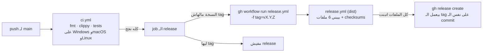

# إزاي بنطلّع release

> **مفيش حد بيعمل tag بإيده.** الـ workflow هو اللي بيعمله، وبيعمله بس لو كل حاجة نجحت.

## الخطوات

1. ارفع النسخة في `Cargo.toml` (`[workspace.package] version`)، مثلاً `0.1.0-alpha.2` أو `0.1.0`.
2. ضيف قسم في `CHANGELOG.md` بالشكل ده: `## 0.1.0-alpha.2 - YYYY-MM-DD`، بالعربي وتحته الإنجليزي.
3. **حدّث `README.md` و`README.en.md` في نفس الـ commit** لأي حاجة اليوزر بيشوفها (أمر جديد، إعداد، شكل، حد اتشال). وغيّر رقم النسخة في أوامر التثبيت للنسخة الجديدة. الـ README لازم يوصف مرآة زي ما هي النهارده، مش زي ما كانت. (قرار المالك، 2026-11-06)
4. اعمل push لـ `main`.

وده اللي بيحصل بعد كده لوحده:

## الحماية
- **النسخة مابتتحرقش لو حاجة فشلت.** الـ tag بيتعمل في آخر خطوة بس (`gh release create --target <commit>`)، بعد ما كل الملفات تتبني.
- **مفيش release مرتين لنفس النسخة.** لو `vX.Y.Z` ليها tag خلاص، الـ job بيعدّي من غير ما يعمل حاجة.
- **مفيش رجوع لورا.** النسخة لازم تبقى أكبر من آخر tag أو زيه، والمقارنة على الأرقام الأساسية بس. يعني `0.1.0-alpha.2` بعد `alpha.1` مسموحة، و`0.1.0` بعد `0.1.0-alpha.2` مسموحة.
- **لازم يكون فيه CHANGELOG.** لو مفيش قسم للنسخة، الـ job بيفشل.
- **بيتنشر الـ commit اللي نجح في الـ CI بس.** لو `main` اتحرك في النص، الـ push الأحدث هو اللي هيطلّع الـ release.
- **ليه dispatch ومش tag push؟** أي tag بيعمله `GITHUB_TOKEN` مابيشغّلش workflows تانية. لكن `workflow_dispatch` مسموح بيه. وده متظبط في dist بـ `dispatch-releases = true`.
- **النسخة prerelease (فيها `-`):** dist بيعلّم الـ release إنه prerelease لوحده.
