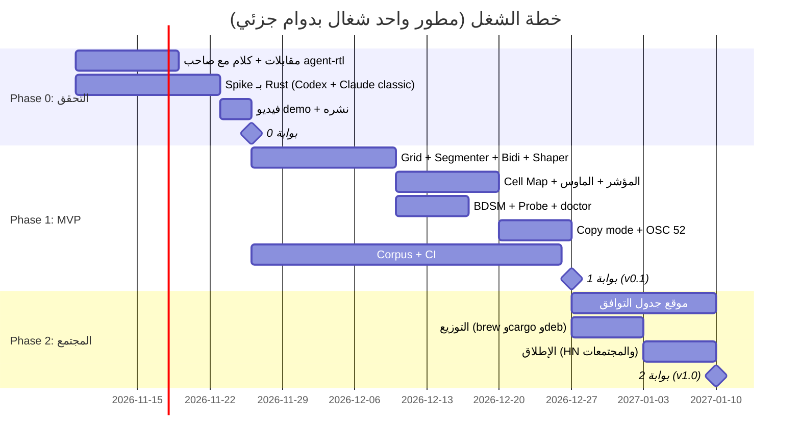

# خارطة الطريق

> كل مرحلة ليها **بوابة**: لو المرحلة ماعدّتش البوابة بتاعتها، بنقف ونعيد التقييم قبل ما نكمّل.

---

## Phase 0: التحقق (أسبوعين)

**الهدف:** نعرف هل في ناس عايزة الأداة بجد، وهل الفكرة بتشتغل مع agent حقيقي، قبل ما نصرف 6 أسابيع.

### T0.1 مقابلات مع المستخدمين
- **المطلوب:** 8 مقابلات أو أكتر (4 عرب و4 عبريين على الأقل) مع ناس بيستخدموا Claude Code أو Codex أو Gemini في الـ terminal.
- **الأسئلة:** بتكتب بلغتك في الـ prompt قد إيه في الأسبوع؟ بتستخدم أنهي ترمنال وأنهي نظام؟ عملت إيه لما لقيت النص مكسور؟ هتشغّل `mirah codex` بدل `codex`؟ إيه اللي ممكن يخليك تبطّل تستخدمها؟
- **فين نلاقيهم:** الناس اللي كتبوا issues في #37183 و#99046 و#19504، وجروبات المطورين العرب، والناس اللي ضافوا نجوم لـ claude-code-rtl-extension.
- **المخرَج:** `Plan/Research/Interviews.md` فيه جدول بالنتايج، ومعاه الجمل اللي قالوها بالنص.
- **حالات حرجة:** لو أقل من 3 من الـ 8 بيكتبوا بلغتهم كل يوم، ده دليل قوي ضد الفكرة.

### T0.2 الكلام مع صاحب agent-rtl
- **المطلوب:** issue أو رسالة لـ mehbylabs نعرض فيها نشتغل على corpus اختبارات مشترك، ونسأله إيه خطته.
- **المخرَج:** نختار واحد من تلاتة: نتعاون معاه، أو كل واحد يكمّل لوحده، أو نساهم في مشروعه بدل ما نبني مشروع جديد.
- **حالات حرجة:** لو مارَدّش في 7 أيام نكمّل لوحدنا، والـ corpus يفضل مفتوح للكل.

### T0.3 Spike بـ Rust
- **المطلوب:** binary بيشغّل أي أمر جوه pty ويطبّق الـ segmenter والـ bidi والـ shaper على الشاشة. بيتجرّب على Codex CLI وعلى Claude Code بـ `CLAUDE_CODE_DISABLE_ALTERNATE_SCREEN=1`.
- **الترمنالات:** GNOME Terminal (BDSM) وKitty (من غير bidi) وiTerm2 3.7 (BDSM).
- **المرجع:** الـ spike بتاع Python في ``research/spike-python/spike.py``.
- **ينجح لو:** رد عربي من Claude فيه جدول markdown وكود وأسماء ملفات ظهر صح. الإطارات مكانها، والكلام الإنجليزي جوه الجمل العربية مش معكوس، والحروف متوصلة.
- **حالات حرجة:** resize والبرنامج شغال، Ctrl-Z ثم fg، الخروج بـ exit code غلط، الـ emoji وحروف CJK العريضة، والسطر اللي بيلف على السطر اللي بعده.

### T0.4 فيديو demo
- **المطلوب:** فيديو 30 ثانية يورّي قبل وبعد على Codex وClaude Code، ويتنشر على X وReddit وفي الـ issues المرتبطة.

### 🚦 بوابة 0
| المقياس | نكمّل لو | نقف لو |
|---|---|---|
| المقابلات | 5 من 8 أو أكتر قالوا "هستخدمها" | أقل من 3 |
| الـ Spike | اشتغل مع agent حقيقي على ترمنالين | ماعرفناش نحل مشكلة العكس مرتين |
| تفاعل الـ demo | أكتر من 50 interaction أو 5 ناس طلبوا يجربوها | تقريباً مفيش |

---

## Phase 1: MVP ‏v0.1 (حوالي 6 أسابيع)

### T1.1 Screen Grid
- نلف `alacritty_terminal` في struct فيه صفوف منطقية، وعليه علامة dirty لكل صف.
- **حالات حرجة:** alt screen 1049، الـ scroll regions (DECSTBM)، والـ combining marks زي الحركات والشدة وZWNJ اللي في الفارسي.

### T1.2 Run Segmenter
- نطبّق القواعد الستة اللي في `Architecture.md`، ونكتب لكل قاعدة اختبار من الـ corpus.
- **حالات حرجة:** جدول markdown، أسماء ملفات جوه جملة عربية، URLs، الأرقام العربية الشرقية (٠-٩)، والسطور اللي فيها `>` أو `-` في أولها.

### T1.3 Bidi + Shaper
- `unicode-bidi` لكل جزء، والـ shaper بيحوّل للـ Presentation Forms-B، و"لا" بتبقى ligature والعرض بيتظبط بالحشو.
- **حالات حرجة:** الحركات (التشكيل)، الحروف الفارسية (پ چ ژ گ ک ی)، الأقواس المعكوسة (قاعدة L4 mirroring)، والأرقام اللي جواها فاصلة.

### T1.4 Cell Map + المؤشر + الماوس
- خريطة من المنطقي للمرئي ومن المرئي للمنطقي لكل صف. المؤشر بيترسم في مكانه المرئي، وأحداث الماوس SGR 1006 أماكنها بتتعكس.
- **حالات حرجة:** المؤشر في آخر السطر، المؤشر بين جزأين باتجاهين مختلفين، والكتابة على مراحل في الـ prompt.

### T1.5 Capability Probe + BDSM + `doctor`
- الـ DECRQM والـ DA والـ XTVERSION بيشتغلوا مع timeout، وBDSM بيتقفل ويرجع يتفتح عند الخروج وعند SIGTSTP.
- الأمر `mirah doctor` بيطبع الترمنال، وحالة BDSM، وهل الخط فيه Presentation Forms، وتوصية.
- **حالات حرجة:** شغّال جوه tmux، جوه SSH، أو ترمنال مابيردش.

### T1.6 Copy Mode
- مفتاح (مثلاً Ctrl-]) يفتح وضع اختيار بالكيبورد، والنسخ بـ OSC 52 بالنص المنطقي الأصلي.
- **حالات حرجة:** ترمنال مابيدعمش OSC 52 (نرجع لـ pbcopy أو wl-copy)، ونص اختيار بيعدّي على أكتر من سطر.

### T1.7 Corpus + CI
- مجلد `corpus/` فيه ملفات `.vt` من output حقيقي ومعاها الـ snapshot المتوقع، والـ CI بيقارن الاتنين.
- ده **أسهل باب للمساهمة**: أي حد يقدر يسجّل جلسة ويضيفها من غير ما يكتب Rust.

### 🚦 بوابة 1
- الأداة شغالة يومياً مع Claude Code وCodex على GNOME Terminal وiTerm2 وKitty من غير ما تقع.
- الـ latency اللي بتزودها أقل من 5ms لكل frame.
- 50 حالة أو أكتر في الـ corpus، وكلها ناجحة.

---

## Phase 2: v1.0 والمجتمع

- **T2.1 موقع جدول التوافق:** جدول ترمنال × agent × النظام، والنتايج بتيجي من المجتمع عن طريق `mirah doctor --report`.
- **T2.2 التوزيع:** GitHub Releases (macOS arm/x64 وLinux musl) وHomebrew tap و`cargo install`.
- **T2.3 الإطلاق:** Show HN، وr/rust، وجروبات المطورين العرب والعبريين والفرس، ورد في كل issue مرتبطة على GitHub فيه رابط الأداة.
- **T2.4 نشر المكتبة لوحدها:** crate اسمها مثلاً `tui-bidi` لأي TUI أو ترمنال عايز يستخدم نفس المنطق.

### 🚦 بوابة 2 (بعد 90 يوم من الإطلاق)
| المقياس | الهدف |
|---|---|
| ⭐ GitHub | 500 أو أكتر |
| مستخدمين أسبوعياً (تقدير من التحميلات) | 300 أو أكتر |
| مساهمين في الـ corpus | 10 أو أكتر |
| issues من مستخدمين حقيقيين | 30 أو أكتر |

---

## Phase 3: بعد v1.0 (اختياري)

- Windows / ConPTY.
- تحريك الأسهم بالترتيب المرئي.
- PRs لـ Codex وGemini نقترح فيها نفس المنطق جوه التطبيق، والـ crate يكون هو الأساس.

## إمتى نقفل المشروع

- لو Anthropic وOpenAI الاتنين صلّحوا المشكلة جوه تطبيقاتهم بـ BDSM، نحوّل المشروع لمكتبة + corpus بس.
- لو بوابة 0 فشلت.
- لو بعد 90 يوم من الإطلاق أقل من 100 نجمة وأقل من 5 issues من مستخدمين حقيقيين.
