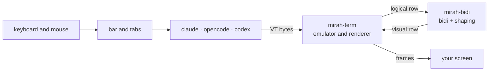

# mirah (مرآة)

[العربية](README.md) · Arabic is the primary documentation language; this is the English translation.

**mirah** runs Claude Code, OpenCode, Codex, Gemini or any other terminal program inside one window, and fixes Arabic before it reaches your screen: text reads right to left, letters are joined, and paragraphs and tables align to the right. Above the program sits an Arabic bar with tabs, settings and recording.

```bash
mirah
```

> ⚠️ **mirah is still alpha.** It has been tested on real recorded Claude Code and OpenCode sessions, on Windows and Linux, but it changes daily. Read [Current limits](#current-limits).

## The problem

Most terminals draw characters left to right, one cell at a time. Arabic comes out **reversed** with **disconnected letters**, and tables and lists stay on the left:

```
What the program wrote:   افتح الملف src/main.rs في السطر 42
What you see:             reversed, letters disconnected
What mirah draws:         42 ﺮﻄﺴﻟﺍ ﻲﻓ src/main.rs ﻒﻠﻤﻟﺍ ﺢﺘﻓﺍ   (reads correctly right to left)
```

Existing fixes each cover one tool or one terminal. mirah sits between the program and the terminal, so it covers any program without touching its code.

## What it does

**Arabic:**
- **Reorders every row** with [UAX #9](https://unicode.org/reports/tr9/). English words, numbers and paths stay left to right inside Arabic text.
- **Joins letters**, including lam-alef and Persian letters (پ چ ژ گ ک ی), with marks kept on their letter, or leaves joining to the terminal, as in Windows Terminal.
- **Aligns prose right:** paragraphs, headings, lists with their markers, and text inside boxes. Code and the command line stay where they are.
- **Mirrors tables**, so the first column is on the right.
- **Understands split screens** such as OpenCode's sidebar and treats each part on its own.
- **Restores the order of programs that reverse Arabic themselves**, such as Claude Code on Windows.
- **Mouse and copy:** a click reaches the program at the word you see, and text the program copies reaches the clipboard in reading order.

**Working:**
- **A picker:** `mirah` on its own looks for the agents installed on your machine and lets you choose.
- **Tabs:** run several programs side by side without leaving.
- **An Arabic bar with settings** that change live and are saved in `config.toml`.
- **Sessions with IDs:** continue any conversation later with `mirah resume`; recordings and logs live in one organised place.
- **One-command updates** with a SHA-256 check.

## Install

### One command

**Windows (PowerShell):**

```powershell
powershell -ExecutionPolicy Bypass -c "irm https://github.com/Khaymah/mirah/releases/download/v0.3.0-alpha.4/mirah-installer.ps1 | iex"
```

**macOS and Linux:**

```bash
curl --proto '=https' --tlsv1.2 -LsSf https://github.com/Khaymah/mirah/releases/download/v0.3.0-alpha.4/mirah-installer.sh | sh
```

This puts mirah in `~/.mirah/bin` and adds it to PATH; open a new terminal afterwards. From then on, `mirah update` fetches any newer version.

> - Every release is still an alpha, which GitHub does not call "latest", so the command names a version. Each release lists its own command.
> - Windows may show a SmartScreen warning the first time, because the binary is not signed yet.

### By hand, with a check

The PowerShell installer does not verify the SHA-256 itself. To check it yourself:

```powershell
curl.exe -LO https://github.com/Khaymah/mirah/releases/download/v0.3.0-alpha.4/mirah-x86_64-pc-windows-msvc.zip
curl.exe -LO https://github.com/Khaymah/mirah/releases/download/v0.3.0-alpha.4/mirah-x86_64-pc-windows-msvc.zip.sha256
(Get-FileHash mirah-x86_64-pc-windows-msvc.zip -Algorithm SHA256).Hash -eq (Get-Content mirah-x86_64-pc-windows-msvc.zip.sha256).Split(" ")[0]
Expand-Archive mirah-x86_64-pc-windows-msvc.zip -DestinationPath "$HOME\.mirah\bin"
```

- **The third command must print `True`:** the file you downloaded is the one the release built.
- **Add `%USERPROFILE%\.mirah\bin` to PATH.**
- **On ARM:** use `aarch64-pc-windows-msvc`.
- **On macOS and Linux:** the same steps with your platform's file, such as `mirah-aarch64-apple-darwin.tar.xz` or `mirah-x86_64-unknown-linux-gnu.tar.xz`.

**Provenance:** every file has a GitHub attestation proving it was built from this repository in GitHub Actions. With the [GitHub CLI](https://cli.github.com):

```bash
gh attestation verify mirah-x86_64-pc-windows-msvc.zip --repo Khaymah/mirah
```

### From source

Requires Rust 1.97 or newer:

```bash
git clone https://github.com/Khaymah/mirah
cd mirah
cargo build --release
```

The binary is at `target/release/mirah`.

### Font

mirah does not change the terminal's font, so pick a monospace font with Arabic:

- **Kawkab Mono:** made for Arabic in the terminal.
- **Cascadia Mono:** ships with Windows Terminal and has Arabic since version 2106.17.
- **DejaVu Sans Mono.**

## First run

```bash
mirah
```

mirah looks for the programs installed on your machine (Claude Code, OpenCode, Codex, Gemini, Qwen, Aider, Crush, Cursor Agent, Amp, Copilot, Goose, then your shell) and opens a picker:

- **The program you used last** is preselected.
- **Below the programs** are recent sessions you can continue.
- **Moving:** arrows and Enter, or the row's number directly.

To start a program directly, without the picker:

```bash
mirah claude
mirah opencode --model gpt-5
```

**On Windows:**
- Programs installed with npm (such as `opencode` and `gemini`) work, because mirah finds their `.cmd` shim.
- If you run from the folder holding `mirah.exe` without adding it to PATH, PowerShell needs `.\mirah.exe`.

## The bar and tabs

The first row belongs to mirah, and the program runs below it:

```
 ✕  ≡  ●                                 + ┃ opencode • ┃▐ claude ▌┃ مرآة ◆
```

| Item | Does |
|---|---|
| A tab | Each tab runs a program; the open one is highlighted. Other tabs keep running, and one with new output shows `•` |
| `+` | A new tab, from the picker |
| `●` | Starts recording this tab; while recording it shows `■` and the time. Press again to stop, and again to continue the same file |
| `↻` | Appears when a new version exists; clicking it installs it for the next start |
| `≡` | Settings |
| `✕` | Closes this tab after asking. Closing the last tab exits mirah |

**Keyboard:**

| Shortcut | Does |
|---|---|
| `Ctrl+]` | Opens the bar: arrows move (reaching a tab opens it), Enter chooses, Esc returns to the program |
| `Ctrl+]` then `1` to `9` | Goes to that tab |
| `Ctrl+]` then `t` | A new tab |
| `Ctrl+]` twice | Sends `Ctrl+]` to the program |

**Mouse:** clicking the bar works when the program asks for the mouse, as Claude Code and OpenCode do. mirah never captures the mouse on its own, so the terminal's normal selection keeps working.

## Settings

`≡` opens a menu; each setting changes live, for every program or for this one only:

| Setting | Choices | Does |
|---|---|---|
| Alignment | all text · Arabic only · off | Aligns prose right, Arabic and English, or Arabic only |
| Mirror tables | on · off | First column on the right |
| Record every session | on · off | Every new tab is recorded into its session folder |
| Copy on select | on · off | Claude Code copies anything you select. Off keeps selection from changing the clipboard |
| Check for updates | on · off | Looks for a new version in the background |
| **Advanced:** letter joining | auto · mirah · terminal | Who joins letters; Windows Terminal joins them itself |
| **Advanced:** program text order | auto · logical · visual | "Visual" for programs that reverse Arabic themselves, such as Claude Code on Windows |
| **Advanced:** map mouse clicks | on · off | A click reaches the program at the word you see |

### The settings file

The menu saves to `config.toml`, in `%APPDATA%\mirah\` on Windows and `~/.config/mirah/` elsewhere. You can edit it by hand, and your comments are kept:

```toml
align = "prose"
record = true

[programs.opencode]
align = "arabic"

[[agents]]
name = "work"
title = "Claude (work)"
command = "claude-work"
resume = ["--continue"]
```

- **`[programs.X]`** holds settings for one program.
- **`[[agents]]`** adds a program to the picker, even one mirah does not look for.
- **What wins:** `MIRAH_*` variables, then the program's section, then the global settings.
- **A broken file:** mirah uses the defaults and never writes over it.

### Environment variables

| Variable | Values | Does |
|---|---|---|
| `MIRAH_ALIGN` | `prose`, `arabic`, `off` | Same as the alignment setting |
| `MIRAH_SHAPING` | `full`, `plain` | `full`: mirah joins letters. `plain`: the terminal joins them |
| `MIRAH_INPUT` | `logical`, `visual` | Same as "program text order" |
| `MIRAH_BAR` | `0` | Hides the bar, so the program gets the whole screen |
| `MIRAH_NO_UPDATE_CHECK` | `1` | Turns off the update check |
| `MIRAH_CONPTY` | `system` | Windows: use the ConPTY that ships with Windows instead of the newer one bundled with mirah |
| `MIRAH_RECORD` | a file path | Records the program's output to that file |
| `MIRAH_LOG` | `debug` | Writes a log to `%LOCALAPPDATA%\mirah\mirah.log` or `~/.local/state/mirah/mirah.log` |

## Sessions and recording

Every tab is a session with a short ID such as `1106-0457-k3f2` and a folder in `%LOCALAPPDATA%\mirah\sessions\` on Windows and `~/.local/state/mirah/sessions/` elsewhere, holding:

- **`session.toml`:** the program, the command, the folder, and when it started and ended.
- **`output.vt`:** the recording, when recording was on.
- **`mirah.log`:** the log, when recording was on from the start.

```bash
mirah sessions
mirah resume 1106-0457-k3f2
mirah --record claude
```

- **`mirah sessions`:** lists recent sessions and the folder.
- **`mirah resume <ID>`:** continues the same conversation. It opens the same program in the same folder with that program's own continue option (`claude --continue`, `opencode --continue`, `codex resume --last`, `gemini --resume`) and keeps recording into the same file. Without an ID it continues the newest session.
- **`mirah --record`:** records this session with a full log, and prints the ID when you exit.
- **Cleanup:** mirah keeps the newest 50 sessions, or the last 14 days if that is more.

> **A recording can contain paths from your machine or anything shown on screen.** Review it before attaching it to a bug report.

## Updating

```bash
mirah update
```

- Looks for the newest release, alphas included.
- If there is a newer one, it downloads it and **checks its SHA-256** before replacing `mirah`. If the checksum does not match, nothing changes.
- The bar also checks in the background and shows `↻` when it finds a new version.
- Needs `curl` and `tar`, which Windows 10 and 11, macOS and Linux all ship.

## Terminals

| Terminal | Has bidi | Turns it off with BDSM | What mirah does |
|---|---|---|---|
| Windows Terminal | ❌ | not needed | Reorders; the terminal joins letters. mirah bundles a newer ConPTY |
| GNOME Terminal / VTE | ✅ | ✅ | Turns the terminal's bidi off and reorders itself |
| iTerm2 3.7 | ✅ | ✅ | Turns the terminal's bidi off and reorders itself |
| Kitty · Alacritty · Ghostty | ❌ | not needed | Reorders and joins letters |
| VS Code · Cursor (xterm.js) | ❌ | not needed | Reorders and joins letters |
| Konsole | ✅ | ❌ | ⚠️ text is reversed twice. Turn bidi off in Konsole's settings |

> This table comes from [research](Plan/MarketResearch.md) and the owner's use of Windows Terminal, not from testing every terminal. If you try one, add your result.

## Current limits

- **The terminal's own selection:** selecting in a program that does not ask for the mouse makes the terminal copy what is on screen, in visual order. Copies made by the program (such as Claude Code) arrive correctly.
- **Selecting several characters inside an Arabic word** (as in vim's visual mode) breaks the word. Details in [Plan/FakeCursor.md](Plan/FakeCursor.md).
- **Alignment guesses** what is prose and what is code from colours and symbols. If an Arabic line stays on the left, send a screenshot or a recording.
- **Scrollback:** mirah runs on the alternate screen, so text that scrolled off the top does not come back.
- **Windows** is still being tested. mirah unpacks a newer ConPTY (from Microsoft, MIT licensed) into `%LOCALAPPDATA%\mirah\conpty\` the first time. Details in [ADR-0004](Plan/ADR/0004-bundle-conpty-on-windows.md).

## How it works



| Crate | Responsibility |
|---|---|
| [`mirah-bidi`](crates/mirah-bidi) | Reordering, letter joining and restoring order. No I/O, builds for WebAssembly, so any terminal can use it |
| [`mirah-term`](crates/mirah-term) | The emulator: bytes in, frames out. Row classification, alignment, tables, split screens and copying. Tested without a pty |
| [`mirah`](crates/mirah) | The program: tabs, the bar, settings, sessions, updates and the pty |

Decisions and their reasons are in [`Plan/ADR`](Plan/ADR), and each day of work in [`Plan/Progress`](Plan/Progress).

## Contributing

**The easiest contribution needs no code: add a corpus case.** If a row renders wrong, add it to `corpus/rows/` in this format:

```
L|the row as the program wrote it
V|the row as it should appear
```

Before any PR:

```bash
cargo fmt --all
cargo clippy --workspace --all-targets -- -D warnings
cargo test --workspace
```

- **No comments in code.** The reason behind any decision goes in `Plan/ADR/`.
- **`unwrap`, `expect` and `panic` are not allowed** outside tests.
- **Documentation is Arabic first, with English as the alternative.**
- **mirah's own interface** has rules in [`.claude/skills/mirah-ui`](.claude/skills/mirah-ui/SKILL.md): direction, simplified Standard Arabic wording, glyphs and colours.
- **Releases:** bump the version in `Cargo.toml`, add a `CHANGELOG.md` section and push; CI creates the tag and the release. Details in [Plan/Releasing.md](Plan/Releasing.md).

## License

MIT · see [LICENSE](LICENSE)
