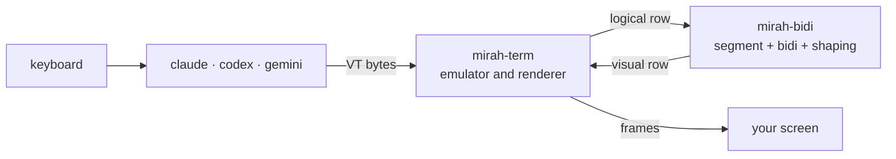

# mirah (مرآة)

[العربية](README.md) · Arabic is the primary documentation language; this is the English translation.

**mirah** runs any terminal program inside it and fixes Arabic, Persian and Hebrew text before it reaches your screen. It works with Claude Code, Codex, Gemini CLI or any other program, without touching that program's code.

```bash
mirah claude
mirah codex
mirah gemini
```

> ⚠️ **Experimental.** mirah has been tested on emulated terminals and recorded sessions. It has not yet been tested widely on real terminals. Read [Current limits](#current-limits) before relying on it.

## The problem

Most terminals draw characters left to right, one cell at a time. Arabic text comes out **reversed** with **disconnected letters**:

```
What the program wrote:   افتح الملف src/main.rs في السطر 42
What you see:             reversed, letters disconnected
What mirah draws:         42 ﺮﻄﺴﻟﺍ ﻲﻓ src/main.rs ﻒﻠﻤﻟﺍ ﺢﺘﻓﺍ   (reads correctly right to left)
```

Existing fixes each cover one tool or one terminal. mirah works at the terminal level, so it covers any program.

## What it does

- **Splits each row before reordering it.** Frames (`│ ╭ ─`) and columns stay in place, and each sentence is reordered on its own.
- **Applies [UAX #9](https://unicode.org/reports/tr9/)** to each sentence. English words, numbers and paths stay left to right inside Arabic text.
- **Joins letters**, including the lam-alef ligature and Persian letters (پ چ ژ گ ک ی). Diacritics stay with their letters.
- **Turns off the terminal's own bidi** with BDSM (`CSI 8 l`) so text is not reversed twice, and restores it on exit.
- **Moves the real cursor** to its visual position.
- **Redraws only the rows that changed**, inside synchronized output.

## Install

### One command

**Windows (PowerShell):**

```powershell
powershell -ExecutionPolicy Bypass -c "irm https://github.com/Khaymah/mirah/releases/download/v0.1.0-alpha.10/mirah-installer.ps1 | iex"
```

**macOS and Linux:**

```bash
curl --proto '=https' --tlsv1.2 -LsSf https://github.com/Khaymah/mirah/releases/download/v0.1.0-alpha.10/mirah-installer.sh | sh
```

This puts mirah in `~/.mirah/bin` and adds it to PATH. Open a new terminal afterwards. From then on `mirah update` brings any newer version, so even if this command names an older release, mirah offers the update the first time it starts.

> Every release is still an alpha, and GitHub does not count those as "latest", so the command has to name a version. Each release lists its own command.

> Windows may show a SmartScreen warning the first time because the file is not signed yet.

### By hand, with a check

The PowerShell installer does not check the SHA-256 itself. To check it yourself:

```powershell
curl.exe -LO https://github.com/Khaymah/mirah/releases/download/v0.1.0-alpha.10/mirah-x86_64-pc-windows-msvc.zip
curl.exe -LO https://github.com/Khaymah/mirah/releases/download/v0.1.0-alpha.10/mirah-x86_64-pc-windows-msvc.zip.sha256
(Get-FileHash mirah-x86_64-pc-windows-msvc.zip -Algorithm SHA256).Hash -eq (Get-Content mirah-x86_64-pc-windows-msvc.zip.sha256).Split(" ")[0]
Expand-Archive mirah-x86_64-pc-windows-msvc.zip -DestinationPath "$HOME\.mirah\bin"
```

The third command must print `True`, which means the downloaded file is the one the release built and nothing changed it. Add `%USERPROFILE%\.mirah\bin` to your PATH. On ARM machines use `aarch64-pc-windows-msvc`. On macOS and Linux, use the file for your machine, such as `mirah-aarch64-apple-darwin.tar.xz` or `mirah-x86_64-unknown-linux-gnu.tar.xz`.

**Provenance:** from `0.1.0-alpha.10`, every file has a GitHub attestation proving it was built from this repository in GitHub Actions. With the [GitHub CLI](https://cli.github.com):

```bash
gh attestation verify mirah-x86_64-pc-windows-msvc.zip --repo Khaymah/mirah
```

### From source

You need Rust 1.97 or newer:

```bash
git clone https://github.com/Khaymah/mirah
cd mirah
cargo build --release
```

The binary is at `target/release/mirah`.

## Usage

```bash
mirah claude
```

With no command, mirah opens your shell.

### The mirah bar

mirah keeps the first row of the screen for an Arabic bar, and the program runs below it:

```
 ✕   ↻ 0.2.1   ● تسجيل   ⚙ الإعدادات                         ◆ مرآة · claude
```

- **`Ctrl+]`** opens the bar. Arrows move, Enter chooses, Esc returns to the program. Pressing `Ctrl+]` twice sends it to the program.
- **Mouse:** clicking the bar works when the program asks for the mouse, as Claude Code does. mirah never captures the mouse on its own, so normal text selection keeps working.
- **⚙ Settings:** alignment, letter joining, the program's text order, table mirroring, mouse mapping and the update check. Changes show at once and apply to every program or to this one only.
- **● Record:** starts saving `claude-session-N.vt` (named after the program) in the current folder; press again to stop, and again to continue the same file.
- **↻:** appears when a new version exists; clicking it installs it for the next start.
- **✕:** asks first, then closes the program and mirah.

### The settings file

The bar saves to `config.toml`, in `%APPDATA%\mirah\` on Windows and `~/.config/mirah/` elsewhere. You can edit it by hand, and your comments are kept:

```toml
align = "prose"
shaping = "auto"
update_check = true

[programs.opencode]
align = "arabic"
```

`MIRAH_*` variables win over a program's section, which wins over the global settings. If the file is broken, mirah uses the defaults and never writes over it.

### Updating

```bash
mirah update
```

This looks for the newest release, alphas included. If there is a newer one, it downloads it, **checks its SHA-256**, and replaces `mirah` with it. If the checksum does not match, nothing changes. The new version runs from the next start.

At startup mirah checks for a newer version and keeps the result for an hour. If there is one, a line with two buttons appears: **Install** and **Later**. Move between them with the arrows or Tab, confirm with Enter, and Esc means Later. After Later, mirah does not ask again about the same version for 24 hours. The check needs `curl` and `tar`, which Windows 10 and 11, macOS and Linux all ship.

### Recording a session for a bug report

```bash
mirah --record claude
```

This saves `claude-session-N.vt` (the program's raw output) and `claude-session-N.log` (a full log), named after the program, **in the current folder**, numbered after the last session already there. mirah prints where they are when you exit.

> A recording can contain paths from your machine or anything shown on screen. Review it before sending it.

**On Windows:** programs installed with npm (such as `opencode` and `gemini`) work, because mirah finds their `.cmd` shim on PATH. If you run from the folder that holds `mirah.exe` without adding it to PATH, PowerShell needs `.\mirah.exe`.

### Settings

| Variable | Values | What it does |
|---|---|---|
| `MIRAH_ALIGN` | `prose` (default), `arabic`, `off` | Right-align prose (Arabic and English), Arabic only, or nothing |
| `MIRAH_SHAPING` | `full`, `plain` | `full`: mirah joins letters. `plain`: the terminal joins them, picked automatically in Windows Terminal |
| `MIRAH_INPUT` | `logical`, `visual` | `visual`: the program reorders Arabic itself before sending it. mirah puts each row back in logical order and checks that this reproduces exactly what the program drew; when it cannot confirm that, it keeps the row as drawn and only fixes brackets. Picked automatically for Claude Code on Windows |
| `MIRAH_CONPTY` | `system` | Windows: use the ConPTY that ships with Windows instead of the newer one bundled with mirah |
| `MIRAH_BAR` | `0` | Hides the mirah bar so the program gets the whole screen |
| `MIRAH_NO_UPDATE_CHECK` | `1` | Turns off the new-version check at startup |
| `MIRAH_RECORD` | file path | Saves the program's raw output so you can attach it to a bug report |
| `MIRAH_LOG` | `debug` | Writes a log file |

To see what happens inside without printing anything to the screen:

```bash
MIRAH_LOG=debug mirah codex
```

The log is written to `~/.local/state/mirah/mirah.log`, or `%LOCALAPPDATA%\mirah\mirah.log` on Windows. With `--record` it goes to the current folder.

## Terminals

| Terminal | Has bidi | Can turn it off (BDSM) | What mirah does |
|---|---|---|---|
| GNOME Terminal / VTE | ✅ | ✅ | Turns off its bidi and reorders itself |
| iTerm2 3.7 | ✅ | ✅ | Turns off its bidi and reorders itself |
| Kitty · Alacritty · Ghostty | ❌ | Not needed | Reorders and joins letters |
| VS Code · Cursor (xterm.js) | ❌ | Not needed | Reorders and joins letters |
| Konsole | ✅ | ❌ | ⚠️ Text is reversed twice. Turn off bidi in Konsole's settings |
| Windows Terminal | ❌ | Not needed | ⚠️ Experimental: reorders, and the terminal joins letters |

> This table comes from [research](Plan/MarketResearch.md) and published reports, not from testing every terminal. If you test one, please add your result.

You need a font with **Arabic Presentation Forms-B**, such as DejaVu Sans Mono.

## Current limits

- **Selections inside an Arabic word:** the fake cursor that Claude Code and other Ink-based programs draw works correctly. Selecting more than one letter inside an Arabic word (such as vim visual mode) still splits the word. See [Plan/FakeCursor.md](Plan/FakeCursor.md).
- **Copying:** selecting text with the mouse copies shaped letters in visual order. A mirah copy mode will fix this.
- **Mouse:** when the program asks for SGR mouse reports (as Claude Code does), mirah maps each click from the screen back to the program's column, so a selection covers the text you see. Other mouse formats pass through unchanged.
- **Scrollback:** mirah runs on the alternate screen, so text that scrolled off the top does not come back.
- **Windows** is still experimental. mirah bundles a newer ConPTY (from Microsoft, MIT licensed) and extracts it to `%LOCALAPPDATA%\mirah\conpty\` on first run. See [ADR-0004](Plan/ADR/0004-bundle-conpty-on-windows.md) (Arabic).

## How it works



| Crate | Responsibility |
|---|---|
| [`mirah-bidi`](crates/mirah-bidi) | Pure logic with no I/O. Builds for WebAssembly, so any terminal can use it |
| [`mirah-term`](crates/mirah-term) | VT bytes in, frames out, and answers terminal queries. Tested without a pty |
| [`mirah`](crates/mirah) | The program itself: pty, threads, logging, and restoring the terminal |

Decisions and their reasons are in [`Plan/ADR`](Plan/ADR) (Arabic). All research is in [`Plan`](Plan).

## Contributing

**The easiest contribution needs no code: add a case to the corpus.** If you find a row that renders wrong, add it to `corpus/rows/` in this format:

```
L|the row as the program wrote it
V|the row as it should appear
```

Before opening a PR:

```bash
cargo fmt --all
cargo clippy --workspace --all-targets -- -D warnings
cargo test --workspace
```

**Releasing:** bump the version in `Cargo.toml`, add a `CHANGELOG.md` section, and push. CI creates the tag and the release. See [Plan/Releasing.md](Plan/Releasing.md) (Arabic).

Rules:
- **No comments in code.** The reason behind a decision goes in `Plan/ADR/`.
- `unwrap`, `expect` and `panic` are not allowed outside tests.
- Documentation is **Arabic first, English as the alternative**.

## License

MIT · see [LICENSE](LICENSE)
