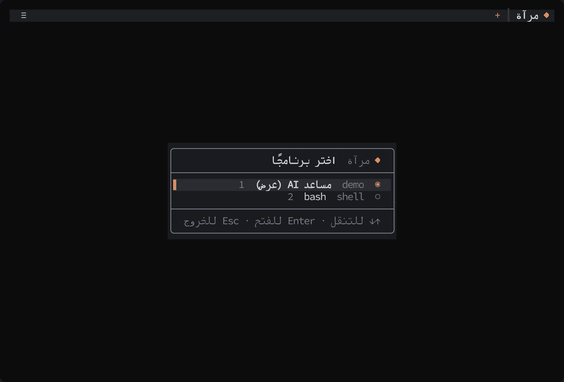
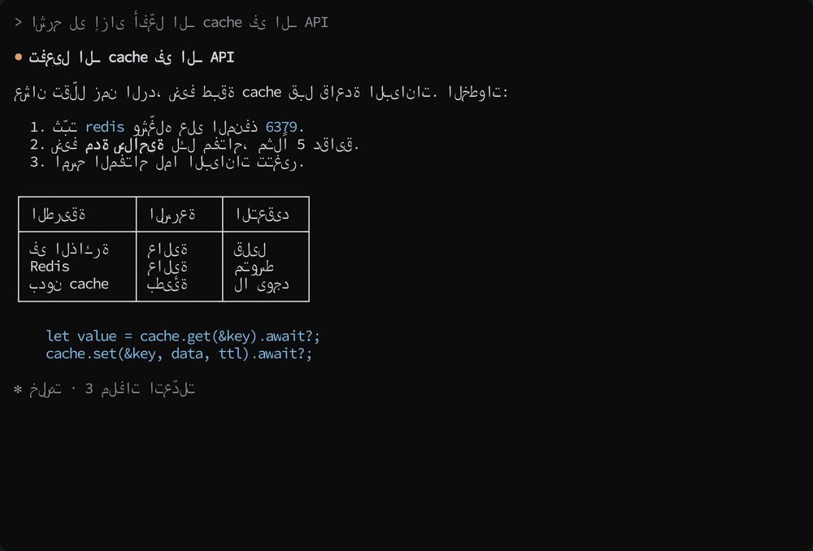
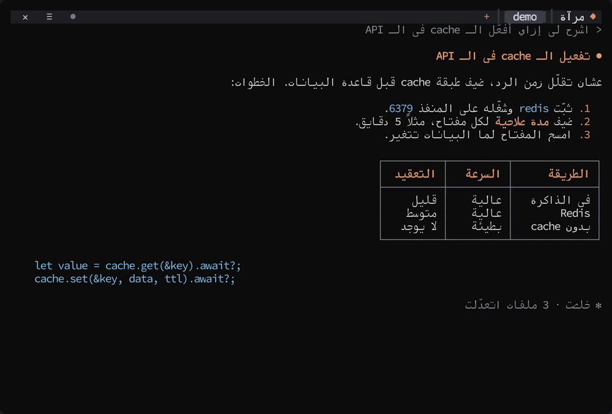
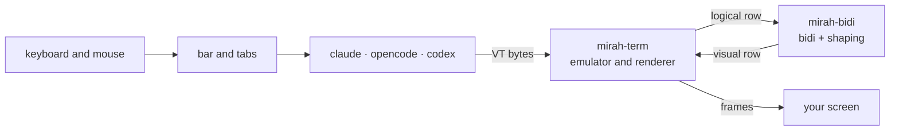

# mirah (مرآة)

[العربية](README.md)

[](https://github.com/Khaymah/mirah/actions/workflows/ci.yml)
[](https://github.com/Khaymah/mirah/releases/latest)
[](LICENSE)

**mirah** is an open-source tool from [Khaymah (خيمة)](https://github.com/Khaymah). It runs Claude Code, OpenCode, Codex, Gemini, or any other terminal program, and fixes Arabic before it reaches your screen:
- Text reads right to left, with joined letters.
- Paragraphs and tables are aligned to the right.
- An Arabic bar above the program holds tabs and settings.

<p align="center"></p>

<p align="center"><a href="docs/images/tour.gif">A full 46-second tour: tabs, settings and the Markdown viewer</a></p>

| Without mirah | With mirah |
|---|---|
|  |  |

> Both images show the same reply, once in a plain terminal and once through mirah. The reply is scripted in [`docs/demo`](docs/demo), and the images come from a real run of mirah.

## Install

**Windows (PowerShell):**

```powershell
powershell -ExecutionPolicy Bypass -c "irm https://github.com/Khaymah/mirah/releases/latest/download/mirah-installer.ps1 | iex"
```

**macOS and Linux:**

```bash
curl --proto '=https' --tlsv1.2 -LsSf https://github.com/Khaymah/mirah/releases/latest/download/mirah-installer.sh | sh
```

- The installer puts mirah in `~/.mirah/bin` and adds it to PATH, so open a new terminal afterwards.
- After that, `mirah update` fetches any newer version.
- Windows may show a SmartScreen warning the first time, because the file is not code-signed.
- Want to check the file yourself, or build from source? See [Manual install](#manual-install).

**Font:** mirah does not change the terminal font, so pick a monospace font with Arabic:
- **[Kawkab Mono](http://makkuk.com/kawkab-mono):** made for Arabic in the terminal.
- **Cascadia Mono:** ships with Windows Terminal and has Arabic since version 2106.17.
- **DejaVu Sans Mono.**

## First run

```bash
mirah
```

mirah looks for the programs you have installed and opens a picker:
- **Programs it looks for:** Claude Code, OpenCode, Codex, Gemini, Qwen, Aider, Crush, Cursor Agent, Amp, Copilot, Goose, and last your shell.
- **The last program you used** is selected.
- **Below the programs** are recent sessions you can continue, and recent Markdown files and recordings in the folder.
- **Moving around:** arrows and Enter, or the line number directly.

To start a program without the picker:

```bash
mirah claude
mirah opencode --model gpt-5
```

> On Windows, programs installed with npm (such as `codex` and `gemini`) just work. If you run mirah from its own folder without adding it to PATH, PowerShell needs `.\mirah.exe`.

> mirah is for programs that run **inside** the terminal. For programs that open their own window, such as `notepad` or VS Code's `code`:
> - On Windows, mirah tells from the exe that it opens a window, and says so without starting it.
> - If a program ends within 3 seconds without showing anything, mirah explains why on exit and keeps no session for it.

## What it does

**Arabic:**
- **Orders every line** with [UAX #9](https://unicode.org/reports/tr9/). English, numbers and paths stay left to right inside Arabic text.
- **Joins letters**:
  - Including lam-alef and the Persian letters (پ چ ژ گ ک ی).
  - Diacritics stay on their letter.
  - Or lets the terminal join them, as Windows Terminal does.
- **Aligns text right:** paragraphs, headings, lists with their markers, and text inside boxes. Code and the command line stay where they are.
- **Mirrors tables**, so the first column is on the right and an Arabic table moves to the right edge.
- **Highlights Markdown** on screens with Arabic: headings, bold text and table headers.
- **Understands split screens**, such as the OpenCode sidebar.
- **Undoes programs that reverse Arabic themselves**, such as Claude Code on Windows.
- **Mouse and copy:**
  - A click reaches the program at the word you see.
  - Text the program copies reaches the clipboard in the right order.

**Work:**
- **Tabs:** several programs side by side, without leaving.
- **An Arabic bar with settings:** every setting changes live and is saved in `config.toml`.
- **Sessions with IDs:** continue any conversation later with `mirah resume`.
- **A Markdown viewer:** read any `.md` file right to left, and save a copy to Downloads.
- **Recording playback:** any `.vt` recording plays inside mirah as the program ran.
- **One-command updates**, with a SHA-256 check.

## The bar and tabs

The first line of the screen belongs to mirah, and the program runs in the rest:

```
 ✕  ≡  ●                                 + ┃ opencode • ┃▐ claude ▌┃ مرآة ◆
```

| Item | What it does |
|---|---|
| A tab | Each tab runs a program; the open one is highlighted. Other tabs keep running, and one with new output shows `•` |
| `+` | A new tab, from the picker |
| `●` | Starts recording this tab. While recording it becomes a red `■` with the elapsed time; press it again to stop |
| `↻` | Shown when a new version is out; pressing it installs it for next time |
| `≡` | Settings |
| `✕` | Closes this tab after asking. When the last tab closes, mirah exits |

**Keyboard:**

| Shortcut | What it does |
|---|---|
| `Ctrl+]` | Opens the bar: arrows move, Enter chooses, Esc returns to the program. Works in the picker too |
| `Ctrl+]` then `1` to `9` | Goes to that tab |
| `Ctrl+]` then `t` | A new tab |
| `Ctrl+]` then `q` | Closes mirah and every program in it. Programs get up to about a second to save their work |
| `Ctrl+]` twice | Sends `Ctrl+]` to the program |

> Letters work with an Arabic keyboard layout too: `t` is `ف`, `q` is `ض`, and Arabic digits `١`–`٩` work.

**Mouse:** the bar, tabs and ✕ work with the mouse in any program.
- **Normal selection** in programs that do not use the mouse (such as Codex and the shell) is `Shift` + drag.
- **The wheel** in those programs becomes up and down arrows.
- **Want selection without `Shift`?** Turn off "mouse for the bar, always" in the advanced options. The bar then takes clicks only in programs that use the mouse, such as Claude Code and OpenCode.

## Settings

`≡` opens a menu. Every setting changes live, for all programs or for this one only:

| Setting | Choices | What it does |
|---|---|---|
| Alignment | all text · Arabic only · off | Aligns text right: Arabic and English, or Arabic only |
| Markdown highlighting | on · off | Colours headings, list markers, bold text and table headers. Only on screens with Arabic, and never text that is already coloured |
| Mirror tables | on · off | First column on the right, and Arabic tables on the right edge |
| Record every session | on · off | Every new tab is recorded in its session folder |
| Copy on select | on · off | Claude Code copies whatever you select, and mirah restores the Arabic order in the copy. Off means selecting does not change the clipboard |
| Check for updates | on · off | Looks for a new version in the background |
| **Advanced:** letter joining | auto · mirah · terminal | Who joins letters. Windows Terminal joins them itself |
| **Advanced:** program text order | auto · logical · visual | "visual" for programs that reverse Arabic themselves, such as Claude Code on Windows |
| **Advanced:** map mouse clicks | on · off | A click reaches the program at the word you see |
| **Advanced:** mouse for the bar, always | on · off | The bar takes clicks in every program. Off brings back normal selection without `Shift` |

### The settings file

The menu saves to `config.toml`: in `%APPDATA%\mirah\` on Windows and `~/.config/mirah/` elsewhere. You can edit it by hand, and your comments are kept:

```toml
align = "prose"
record = true

[programs.opencode]
align = "arabic"

[[agents]]
name = "work"
title = "Claude (work)"
command = "claude-work"
resume = ["--continue"]
```

- **`[programs.X]`:** settings for one program.
- **`[[agents]]`:** adds a program to the picker.
- **Who wins:** `MIRAH_*` variables first, then the program section, then the global settings.
- **A broken or unreadable file:** mirah runs on defaults and never overwrites it.

### Environment variables

| Variable | Values | What it does |
|---|---|---|
| `MIRAH_ALIGN` | `prose`, `arabic`, `off` | Same as the alignment setting |
| `MIRAH_SHAPING` | `full`, `plain` | `full`: mirah joins letters. `plain`: the terminal does |
| `MIRAH_INPUT` | `logical`, `visual` | Same as "program text order" |
| `MIRAH_BAR` | `0` | Hides the bar, so the program gets the whole screen |
| `MIRAH_NO_UPDATE_CHECK` | `1` | Turns off update checks |
| `MIRAH_CONPTY` | `system` | On Windows: uses the ConPTY built into Windows instead of the newer one bundled with mirah |
| `MIRAH_RECORD` | a file path | Records the output of the program in the first tab to that file |
| `MIRAH_LOG` | `debug` | Writes a log to `%LOCALAPPDATA%\mirah\mirah.log` or `~/.local/state/mirah/mirah.log` |

## Sessions and recording

Every tab is a session with a short ID such as `1106-0457-k3f2`:

```bash
mirah sessions
mirah resume 1106-0457-k3f2
mirah --record claude
```

- **`mirah sessions`:** lists recent sessions and where they are kept.
- **`mirah resume <ID>`:**
  - Continues the same conversation: it opens the same program in the same folder, the way that program resumes (`claude --continue`, `opencode --continue`, `codex resume --last`, `gemini --resume`).
  - Without an ID it continues the last session.
- **`mirah --record`:** records this session with a full log, and prints the ID when you exit.
- **Cleanup:** mirah keeps the last 50 sessions, or the last 14 days if that is more.

**Where sessions are kept:**
- **By default:** a `sessions` folder next to `mirah.exe`.
- **Installed with the installer:** `~/.mirah/sessions`.
- **If mirah cannot write there:** `%LOCALAPPDATA%\mirah\sessions\` on Windows, or `~/.local/state/mirah/sessions/`.
- **A place you choose:** `sessions_dir = "D:/mirah/sessions"` in `config.toml`, and mirah changes nothing else in it.

The sessions folder has a `.gitignore`, so recordings are not added to git by mistake. On Linux and macOS, only you can open it.

Inside each session folder:
- **`session.toml`:** the program, the command, the folder, and when it started and ended. Always written, so `resume` works.
- **`output.vt`:** the recording, if recording was on.
- **`mirah.log`:** the log, if `--record` was used.

> **A recording can contain paths from your machine, or anything that appeared on screen.** Review it before attaching it to a bug report.

## Markdown viewer

```bash
mirah view plan.md
```

Or pick the file in the picker, under "files to view". It opens in a tab:
- **Headings, lists and quotes** on the right.
- **Tables** framed, mirrored, and on the right edge.
- **Code** on the left, left to right even if it contains Arabic.
- **Long lines** wrap to the screen width.

| Key | What it does |
|---|---|
| `↑` `↓` or the wheel | Scroll |
| `PgUp` `PgDn` or space | A full page |
| `Home` `End` | Start and end of the file |
| `S` (or `س`) | Saves a copy to Downloads; with a name clash it becomes `plan (2).md` |
| `Esc` or `Q` (or `ض`) | Closes the tab |

## Playing recordings

```bash
mirah play claude-session-1.vt
mirah play 1106-0457-k3f2
```

Plays a `.vt` recording, or a session's recording by its ID, in a tab, as if the program were running.

| Key | What it does |
|---|---|
| Space | Pause and resume |
| `→` | ×8 faster |
| `End` | Straight to the end |
| `R` | From the start |
| `Esc` or `Q` | Closes the tab |

> A recording does not store the screen size, so it shows correctly in a window of the size it was recorded at.

## Updating

```bash
mirah update
```

- **Looks for the newest version in the Releases:**
  - On a stable version, it only considers stable releases.
  - On an alpha, it considers everything.
- **Before replacing `mirah`,** it checks the download against its SHA-256. If it does not match, nothing changes.
- **The bar also checks in the background**, and shows `↻` when a new version is out.
- **Needs `curl` and `tar`**, which ship with Windows 10 and 11, macOS and Linux.

## Terminals

| Terminal | Has bidi | Turns it off via BDSM | What mirah does |
|---|---|---|---|
| Windows Terminal | ❌ | not needed | Orders text; the terminal joins letters. mirah bundles a newer ConPTY |
| GNOME Terminal / VTE | ✅ | ✅ | Turns its bidi off and orders text itself |
| iTerm2 3.7 | ✅ | ✅ | Turns its bidi off and orders text itself |
| Kitty · Alacritty · Ghostty | ❌ | not needed | Orders text and joins letters |
| VS Code · Cursor (xterm.js) | ❌ | not needed | Orders text and joins letters |
| Konsole | ✅ | ❌ | ⚠️ Text gets reversed twice. Turn bidi off in Konsole's settings |

> Most testing happens on Windows Terminal. The rest of the table comes from each terminal's documentation. If you try a terminal, [tell us how it went](https://github.com/Khaymah/mirah/issues/new/choose).

## Known limits

- **The terminal's own selection:** selecting with the mouse in a program that does not use the mouse makes the terminal copy what is on screen, in visual order. Copies made by the program itself (such as Claude Code) come out right.
- **Selecting several letters inside an Arabic word** (as in vim's visual mode) splits the word. Details in [Plan/FakeCursor.md](Plan/FakeCursor.md).
- **Alignment guesses** what is prose and what is code from colours and symbols. If an Arabic line stays on the left, [send us](https://github.com/Khaymah/mirah/issues/new/choose) a screenshot or a recording.
- **The Markdown viewer** does not show images, only their link, and HTML inside the file shows as text.
- **Scrollback:** mirah runs on the alternate screen, so text that scrolled off the top does not come back with the wheel.
- **ConPTY on Windows:** mirah unpacks a newer ConPTY (from Microsoft, MIT licensed) into `%LOCALAPPDATA%\mirah\conpty\` on first run. Details in [ADR-0004](Plan/ADR/0004-bundle-conpty-on-windows.md).

## Manual install

### With a file check

The PowerShell installer does not verify SHA-256 itself. To check by hand:

```powershell
curl.exe -LO https://github.com/Khaymah/mirah/releases/latest/download/mirah-x86_64-pc-windows-msvc.zip
curl.exe -LO https://github.com/Khaymah/mirah/releases/latest/download/mirah-x86_64-pc-windows-msvc.zip.sha256
(Get-FileHash mirah-x86_64-pc-windows-msvc.zip -Algorithm SHA256).Hash -eq (Get-Content mirah-x86_64-pc-windows-msvc.zip.sha256).Split(" ")[0]
Expand-Archive mirah-x86_64-pc-windows-msvc.zip -DestinationPath "$HOME\.mirah\bin"
```

- **The third command must print `True`.**
- **Add `%USERPROFILE%\.mirah\bin` to PATH.**
- **On ARM:** use `aarch64-pc-windows-msvc`.
- **On macOS and Linux:** the same steps with the matching file, such as `mirah-aarch64-apple-darwin.tar.xz` or `mirah-x86_64-unknown-linux-gnu.tar.xz`.

**Provenance:** every file has a GitHub attestation proving it was built from this repository in GitHub Actions:

```bash
gh attestation verify mirah-x86_64-pc-windows-msvc.zip --repo Khaymah/mirah
```

### From source

Needs Rust 1.97 or newer:

```bash
git clone https://github.com/Khaymah/mirah
cd mirah
cargo build --release
```

The binary ends up in `target/release/mirah`.

## How it works



| Crate | Responsibility |
|---|---|
| [`mirah-bidi`](crates/mirah-bidi) | Ordering, letter joining, and undoing the order. No I/O, and it builds for WebAssembly |
| [`mirah-term`](crates/mirah-term) | The emulator: bytes in, frames out. Line classification, alignment, tables, split screens, copying |
| [`mirah`](crates/mirah) | The program itself: tabs, the bar, settings, sessions, updates, the pty |

Decisions and their reasons are in [`Plan/ADR`](Plan/ADR), and the architecture in [`Plan/Architecture.md`](Plan/Architecture.md).

### Why Rust?

It was not a matter of taste. We tried and compared four options before writing the real code:

| Option | Its role | Why it was not chosen |
|---|---|---|
| **Python** | The first experiment; it proved the idea works | Every user would need Python installed |
| **Bun / Node** | The fastest route to a first version | Needs a runtime and a native pty module, and it is the same stack as earlier tools with the same problems |
| **Go** | Measured against Rust line by line | The official bidi library passed only 66.78%, the terminal emulator was a first release, and Windows needs a separate pty library |
| **Rust** ✅ | The choice | Details below |

**What was measured between Rust and Go:**

| Criterion | Rust | Go |
|---|---|---|
| Text ordering (bidi) on Unicode's official test file, 91,707 cases | **100%** with a very widely used library | 66.78% with the official library; the other one at 100% was three months old with no users |
| Terminal emulator | Same screen; the library has 18 million downloads | Same screen, but the library was a first release |
| Windows (ConPTY) | One API in `portable-pty` | Needs a separate library |
| Speed | Equal | Equal |
| Code size | Longer | **37% shorter** |

**What Rust gave us:**
- **One file** of about 3 MB, with no Node, Python or anything else to install first.
- **No garbage collector**, so no sudden pauses while you type.
- **Direct access to Windows:** mirah bundles a newer ConPTY and ends a program and everything it started when you close its tab.
- **mirah's core** (`mirah-bidi`) is a standalone library that builds for WebAssembly, so any other terminal can use it.

**The cost:** longer code and slower writing at first. We accepted it so Arabic comes out 100% right.

> The numbers are in [`Plan/Research/RustVsGo.md`](Plan/Research/RustVsGo.md), and the decision in [ADR-0001](Plan/ADR/0001-rust-as-language.md).

## Community

mirah is made by [Khaymah (خيمة)](https://github.com/Khaymah). Come talk to us, share feedback, or ask:

- **GitHub:** https://github.com/Khaymah
- **Discussions on Qabilah:** https://qabilah.com/communities/Khaymah
- **WhatsApp group:** https://chat.whatsapp.com/GIixmbibIix8PyUzFBbNoq

## Contributing

Every contribution is welcome, even without code: an Arabic line that shows wrong becomes a two-line corpus case. Details in [CONTRIBUTING.md](CONTRIBUTING.md).

- **Found a problem?** [Open an issue](https://github.com/Khaymah/mirah/issues/new/choose).
- **A security issue?** Do not open a public issue; follow [SECURITY.md](SECURITY.md).

## License

MIT · see [LICENSE](LICENSE)
