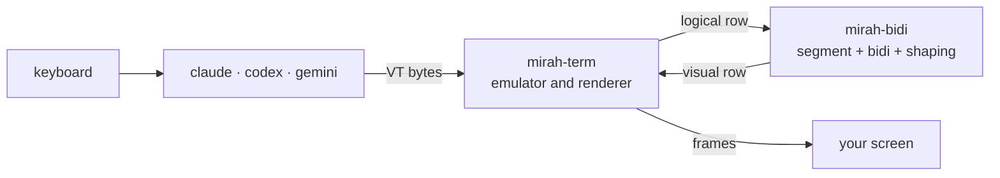

# mirah (مرآة)

[العربية](README.md) · Arabic is the primary documentation language; this is the English translation.

**mirah** runs any terminal program inside it and fixes Arabic, Persian and Hebrew text before it reaches your screen. It works with Claude Code, Codex, Gemini CLI or any other program, without touching that program's code.

```bash
mirah claude
mirah codex
mirah gemini
```

> ⚠️ **Experimental.** mirah has been tested on emulated terminals and recorded sessions. It has not yet been tested widely on real terminals. Read [Current limits](#current-limits) before relying on it.

## The problem

Most terminals draw characters left to right, one cell at a time. Arabic text comes out **reversed** with **disconnected letters**:

```
What the program wrote:   افتح الملف src/main.rs في السطر 42
What you see:             reversed, letters disconnected
What mirah draws:         42 ﺮﻄﺴﻟﺍ ﻲﻓ src/main.rs ﻒﻠﻤﻟﺍ ﺢﺘﻓﺍ   (reads correctly right to left)
```

Existing fixes each cover one tool or one terminal. mirah works at the terminal level, so it covers any program.

## What it does

- **Splits each row before reordering it.** Frames (`│ ╭ ─`) and columns stay in place, and each sentence is reordered on its own.
- **Applies [UAX #9](https://unicode.org/reports/tr9/)** to each sentence. English words, numbers and paths stay left to right inside Arabic text.
- **Joins letters**, including the lam-alef ligature and Persian letters (پ چ ژ گ ک ی). Diacritics stay with their letters.
- **Turns off the terminal's own bidi** with BDSM (`CSI 8 l`) so text is not reversed twice, and restores it on exit.
- **Moves the real cursor** to its visual position.
- **Redraws only the rows that changed**, inside synchronized output.

## Install

### From the Releases page

The repository is still private, so downloading needs a signed-in [GitHub CLI](https://cli.github.com) (`gh auth login`).

**Windows (PowerShell):**

```powershell
gh release download --repo Khaymah/mirah --pattern "mirah-x86_64-pc-windows-msvc.zip"
gh release download --repo Khaymah/mirah --pattern "mirah-x86_64-pc-windows-msvc.zip.sha256"
(Get-FileHash mirah-x86_64-pc-windows-msvc.zip -Algorithm SHA256).Hash -eq (Get-Content mirah-x86_64-pc-windows-msvc.zip.sha256).Split(" ")[0]
Expand-Archive mirah-x86_64-pc-windows-msvc.zip -DestinationPath "$HOME\.mirah\bin"
```

The third command must print `True`, which means the downloaded file is the one the release built and nothing changed it. Add `%USERPROFILE%\.mirah\bin` to your PATH. On ARM machines use `aarch64-pc-windows-msvc`.

> Windows may show a SmartScreen warning the first time because the file is not signed yet.

**macOS and Linux:** the same steps with the file for your machine, such as `mirah-aarch64-apple-darwin.tar.xz` or `mirah-x86_64-unknown-linux-gnu.tar.xz`.

### From source

You need Rust 1.97 or newer:

```bash
git clone https://github.com/Khaymah/mirah
cd mirah
cargo build --release
```

The binary is at `target/release/mirah`.

## Usage

```bash
mirah claude
```

With no command, mirah opens your shell.

### Settings

| Variable | Values | What it does |
|---|---|---|
| `MIRAH_ALIGN` | `prose` (default), `arabic`, `off` | Right-align prose (Arabic and English), Arabic only, or nothing |
| `MIRAH_SHAPING` | `full`, `words` | `full`: mirah joins letters. `words`: the terminal joins them, picked automatically in Windows Terminal |
| `MIRAH_RECORD` | file path | Saves the program's raw output so you can attach it to a bug report |
| `MIRAH_LOG` | `debug` | Writes a log file | To see what happens inside without printing anything to the screen:

```bash
MIRAH_LOG=debug mirah codex
```

The log is written to `~/.local/state/mirah/mirah.log`.

## Terminals

| Terminal | Has bidi | Can turn it off (BDSM) | What mirah does |
|---|---|---|---|
| GNOME Terminal / VTE | ✅ | ✅ | Turns off its bidi and reorders itself |
| iTerm2 3.7 | ✅ | ✅ | Turns off its bidi and reorders itself |
| Kitty · Alacritty · Ghostty | ❌ | Not needed | Reorders and joins letters |
| VS Code · Cursor (xterm.js) | ❌ | Not needed | Reorders and joins letters |
| Konsole | ✅ | ❌ | ⚠️ Text is reversed twice. Turn off bidi in Konsole's settings |
| Windows Terminal | ❌ | | ❌ Windows is not supported yet |

> This table comes from [research](Plan/MarketResearch.md) and published reports, not from testing every terminal. If you test one, please add your result.

You need a font with **Arabic Presentation Forms-B**, such as DejaVu Sans Mono.

## Current limits

- **Selections inside an Arabic word:** the fake cursor that Claude Code and other Ink-based programs draw works correctly. Selecting more than one letter inside an Arabic word (such as vim visual mode) still splits the word. See [Plan/FakeCursor.md](Plan/FakeCursor.md).
- **Copying:** selecting text with the mouse copies shaped letters in visual order. A mirah copy mode will fix this.
- **Mouse:** clicks on Arabic text land on the logical position.
- **Scrollback:** mirah runs on the alternate screen, so text that scrolled off the top does not come back.
- **Windows** is not supported yet.

## How it works



| Crate | Responsibility |
|---|---|
| [`mirah-bidi`](crates/mirah-bidi) | Pure logic with no I/O. Builds for WebAssembly, so any terminal can use it |
| [`mirah-term`](crates/mirah-term) | VT bytes in, frames out, and answers terminal queries. Tested without a pty |
| [`mirah`](crates/mirah) | The program itself: pty, threads, logging, and restoring the terminal |

Decisions and their reasons are in [`Plan/ADR`](Plan/ADR) (Arabic). All research is in [`Plan`](Plan).

## Contributing

**The easiest contribution needs no code: add a case to the corpus.** If you find a row that renders wrong, add it to `corpus/rows/` in this format:

```
L|the row as the program wrote it
V|the row as it should appear
```

Before opening a PR:

```bash
cargo fmt --all
cargo clippy --workspace --all-targets -- -D warnings
cargo test --workspace
```

**Releasing:** bump the version in `Cargo.toml`, add a `CHANGELOG.md` section, and push. CI creates the tag and the release. See [Plan/Releasing.md](Plan/Releasing.md) (Arabic).

Rules:
- **No comments in code.** The reason behind a decision goes in `Plan/ADR/`.
- `unwrap`, `expect` and `panic` are not allowed outside tests.
- Documentation is **Arabic first, English as the alternative**.

## License

MIT · see [LICENSE](LICENSE)
