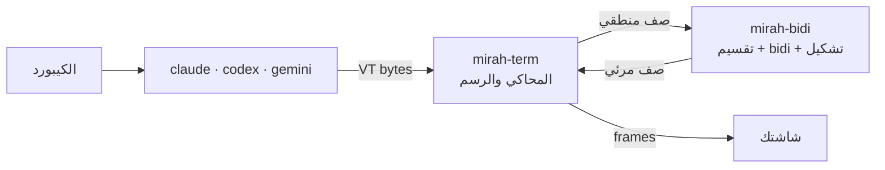

<div dir="rtl">

# مرآة (mirah)

[English](README.en.md)

**مرآة** بتشغّل أي برنامج terminal جواها وتصلّح العربي والفارسي والعبري قبل ما يوصل لشاشتك. شغالة مع Claude Code وCodex وGemini CLI، أو أي برنامج تاني، ومن غير ما تلمس كود البرنامج نفسه.

```bash
mirah claude
mirah codex
mirah gemini
```

> ⚠️ **المشروع لسه في مرحلة تجريبية.** اتجرّب على ترمنالات وهمية وعلى جلسات متسجّلة، ولسه ماتجربش على نطاق واسع في ترمنالات حقيقية. شوف [الحدود الحالية](#الحدود-الحالية) قبل ما تستخدمه.

## المشكلة

أغلب الترمنالات بترسم الحروف من الشمال لليمين، خلية خلية. فالكلام العربي بيظهر **مقلوب** و**حروفه مقطّعة**:

```
اللي البرنامج كتبه:   افتح الملف src/main.rs في السطر 42
اللي بيظهر عندك:      ا ف ت ح  ا ل م ل ف  src/main.rs  ف ي  ...   (مقلوب ومقطّع)
اللي مرآة بترسمه:     42 ﺮﻄﺴﻟﺍ ﻲﻓ src/main.rs ﻒﻠﻤﻟﺍ ﺢﺘﻓﺍ   (بيتقري صح من اليمين)
```

الحلول الموجودة كل واحد منها بيصلّح أداة واحدة أو ترمنال واحد بس. مرآة بتشتغل على مستوى الترمنال نفسه، فبتنفع مع أي برنامج.

## بتعمل إيه

- **بتقسّم السطر قبل ما ترتّبه.** الإطارات (`│ ╭ ─`) والأعمدة بتفضل مكانها، وكل جملة بتترتب لوحدها.
- **بتطبّق [UAX #9](https://unicode.org/reports/tr9/)** على كل جملة. الإنجليزي والأرقام والمسارات بيفضلوا من الشمال لليمين جوه الكلام العربي.
- **بتوصّل الحروف**، ومعاها "لا" والحروف الفارسية (پ چ ژ گ ک ی)، والحركات بتفضل في مكانها.
- **بتقفل الـ bidi بتاع الترمنال** بـ BDSM (`CSI 8 l`)، عشان النص مايتعكسش مرتين، وبترجّعه وانت خارج.
- **بتحرّك المؤشر الحقيقي** لمكانه المرئي.
- **بترسم الصفوف اللي اتغيرت بس**، جوه synchronized output.

## التثبيت

لسه مفيش نسخ جاهزة. محتاج تبنيها من الكود باستخدام Rust 1.97 أو أحدث:

```bash
git clone https://github.com/Khaymah/mirah
cd mirah
cargo build --release
```

الـ binary هيطلع في `target/release/mirah`.

## الاستخدام

```bash
mirah claude
```

من غير ما تكتب أمر، مرآة بتفتح الـ shell بتاعك. وعشان تشوف إيه اللي بيحصل جواها من غير ما يطلع أي حاجة على الشاشة:

```bash
MIRAH_LOG=debug mirah codex
```

الـ log بيتكتب في `~/.local/state/mirah/mirah.log`.

## الترمنالات

| الترمنال | عنده bidi | بيقفله بـ BDSM | مرآة بتعمل إيه |
|---|---|---|---|
| GNOME Terminal / VTE | ✅ | ✅ | بتقفل الـ bidi بتاعه وترتّب هي |
| iTerm2 3.7 | ✅ | ✅ | بتقفل الـ bidi بتاعه وترتّب هي |
| Kitty · Alacritty · Ghostty | ❌ | مش محتاج | بترتّب وتوصّل الحروف |
| VS Code · Cursor (xterm.js) | ❌ | مش محتاج | بترتّب وتوصّل الحروف |
| Konsole | ✅ | ❌ | ⚠️ النص هيتعكس مرتين. اقفل الـ bidi من إعدادات Konsole |
| Windows Terminal | ❌ | | ❌ Windows لسه مش مدعوم |

> الجدول ده جاي من [بحث](Plan/MarketResearch.md) ومن البلاغات المنشورة، مش من تجربة على كل ترمنال. لو جرّبت ترمنال، ضيف نتيجتك.

محتاج خط فيه **Arabic Presentation Forms-B**، زي DejaVu Sans Mono.

## الحدود الحالية

- **تحديد نص جوه كلمة عربي:** المؤشر الوهمي اللي Claude Code وأي برنامج مبني على Ink بيرسموه شغال صح. بس لو حددت أكتر من حرف جوه كلمة عربي (زي visual mode في vim)، الكلمة بتتقطع. التفاصيل في [Plan/FakeCursor.md](Plan/FakeCursor.md).
- **النسخ:** لو حددت نص بالماوس في الترمنال، هيتنسخ بالحروف المتشكّلة وبالترتيب المرئي. هيتحل بـ copy mode خاص بمرآة.
- **الماوس:** الضغط على كلام عربي بيروح لمكانه المنطقي.
- **الـ scrollback:** مرآة شغالة على الـ alternate screen، فالكلام اللي اتمسح من فوق مش هيرجع.
- **Windows** مش مدعوم لحد دلوقتي.

## إزاي بتشتغل



| Crate | المسؤولية |
|---|---|
| [`mirah-bidi`](crates/mirah-bidi) | المنطق الصافي، من غير I/O، وبيتعمله build لـ WebAssembly. أي ترمنال يقدر يستخدمه |
| [`mirah-term`](crates/mirah-term) | يدخله bytes ويطلّع frames، وبيرد على أسئلة الترمنال. بيتختبر من غير pty |
| [`mirah`](crates/mirah) | البرنامج نفسه: الـ pty، والـ threads، والـ logging، وترجيع الترمنال لحالته |

القرارات وأسبابها في [`Plan/ADR`](Plan/ADR)، والبحث كله في [`Plan`](Plan).

## المساهمة

**أسهل مساهمة ومفيهاش كود خالص: ضيف حالة للـ corpus.** لو لقيت سطر بيظهر غلط، ضيفه في `corpus/rows/` بالصيغة دي:

```
L|السطر زي ما البرنامج كتبه
V|السطر زي ما المفروض يظهر
```

وقبل ما تبعت أي PR:

```bash
cargo fmt --all
cargo clippy --workspace --all-targets -- -D warnings
cargo test --workspace
```

القواعد:
- **مفيش comments في الكود.** السبب وراء أي قرار بيتكتب في `Plan/ADR/`.
- `unwrap` و`expect` و`panic` ممنوعين برا الاختبارات.
- التوثيق **عربي أساسي، والإنجليزي بديل**.

## الترخيص

MIT · راجع [LICENSE](LICENSE)

</div>
