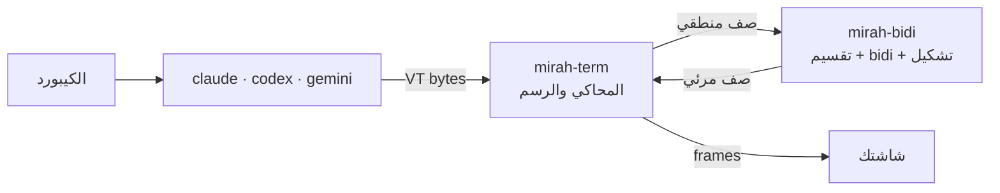

<div dir="rtl">

# مرآة (mirah)

[English](README.en.md)

**مرآة** بتشغّل أي برنامج terminal جواها وتصلّح العربي والفارسي والعبري قبل ما يوصل لشاشتك. شغالة مع Claude Code وCodex وGemini CLI، أو أي برنامج تاني، ومن غير ما تلمس كود البرنامج نفسه.

```bash
mirah claude
mirah codex
mirah gemini
```

> ⚠️ **المشروع لسه في مرحلة تجريبية.** اتجرّب على ترمنالات وهمية وعلى جلسات متسجّلة، ولسه ماتجربش على نطاق واسع في ترمنالات حقيقية. شوف [الحدود الحالية](#الحدود-الحالية) قبل ما تستخدمه.

## المشكلة

أغلب الترمنالات بترسم الحروف من الشمال لليمين، خلية خلية. فالكلام العربي بيظهر **مقلوب** و**حروفه مقطّعة**:

```
اللي البرنامج كتبه:   افتح الملف src/main.rs في السطر 42
اللي بيظهر عندك:      ا ف ت ح  ا ل م ل ف  src/main.rs  ف ي  ...   (مقلوب ومقطّع)
اللي مرآة بترسمه:     42 ﺮﻄﺴﻟﺍ ﻲﻓ src/main.rs ﻒﻠﻤﻟﺍ ﺢﺘﻓﺍ   (بيتقري صح من اليمين)
```

الحلول الموجودة كل واحد منها بيصلّح أداة واحدة أو ترمنال واحد بس. مرآة بتشتغل على مستوى الترمنال نفسه، فبتنفع مع أي برنامج.

## بتعمل إيه

- **بتقسّم السطر قبل ما ترتّبه.** الإطارات (`│ ╭ ─`) والأعمدة بتفضل مكانها، وكل جملة بتترتب لوحدها.
- **بتطبّق [UAX #9](https://unicode.org/reports/tr9/)** على كل جملة. الإنجليزي والأرقام والمسارات بيفضلوا من الشمال لليمين جوه الكلام العربي.
- **بتوصّل الحروف**، ومعاها "لا" والحروف الفارسية (پ چ ژ گ ک ی)، والحركات بتفضل في مكانها.
- **بتقفل الـ bidi بتاع الترمنال** بـ BDSM (`CSI 8 l`)، عشان النص مايتعكسش مرتين، وبترجّعه وانت خارج.
- **بتحرّك المؤشر الحقيقي** لمكانه المرئي.
- **بترسم الصفوف اللي اتغيرت بس**، جوه synchronized output.

## التثبيت

### بأمر واحد

**ويندوز (PowerShell):**

```powershell
powershell -ExecutionPolicy Bypass -c "irm https://github.com/Khaymah/mirah/releases/download/v0.1.0-alpha.10/mirah-installer.ps1 | iex"
```

**macOS وLinux:**

```bash
curl --proto '=https' --tlsv1.2 -LsSf https://github.com/Khaymah/mirah/releases/download/v0.1.0-alpha.10/mirah-installer.sh | sh
```

الأمر بيحط مرآة في `~/.mirah/bin` وبيضيفها للـ PATH. افتح ترمنال جديد بعده، وبعد كده `mirah update` بيجيبلك أي نسخة أحدث. يعني حتى لو الأمر ده لنسخة قديمة، أول ما مرآة تشتغل هتعرض عليك التحديث.

> كل النسخ لسه alpha، وGitHub مابيعتبرش النسخ دي "latest"، فالأمر لازم يبقى لنسخة بعينها. وأي release فيه الأمر بالنسخة بتاعته.

> ويندوز ممكن يطلّع تحذير SmartScreen أول مرة، لأن الملف لسه مش موقّع.

### بإيدك، ومعاه التأكد من الملف

installer الـ PowerShell مابيتأكدش من الـ SHA-256 بنفسه، فلو عايز تتأكد بإيدك:

```powershell
curl.exe -LO https://github.com/Khaymah/mirah/releases/download/v0.1.0-alpha.10/mirah-x86_64-pc-windows-msvc.zip
curl.exe -LO https://github.com/Khaymah/mirah/releases/download/v0.1.0-alpha.10/mirah-x86_64-pc-windows-msvc.zip.sha256
(Get-FileHash mirah-x86_64-pc-windows-msvc.zip -Algorithm SHA256).Hash -eq (Get-Content mirah-x86_64-pc-windows-msvc.zip.sha256).Split(" ")[0]
Expand-Archive mirah-x86_64-pc-windows-msvc.zip -DestinationPath "$HOME\.mirah\bin"
```

لازم الأمر التالت يطبع `True`، وده معناه إن الملف اللي نزل هو نفسه اللي الـ release بناه، ومحدش غيّر فيه. ضيف `%USERPROFILE%\.mirah\bin` للـ PATH. ولو جهازك ARM، استخدم `aarch64-pc-windows-msvc`. وعلى macOS وLinux نفس الخطوات بالملف المناسب لجهازك، مثلاً `mirah-aarch64-apple-darwin.tar.xz` أو `mirah-x86_64-unknown-linux-gnu.tar.xz`.

**إثبات المصدر:** من أول `0.1.0-alpha.10`، كل ملف معاه GitHub attestation. وده بيثبت إنه اتبنى من الريبو ده في GitHub Actions. ولو عندك [GitHub CLI](https://cli.github.com):

```bash
gh attestation verify mirah-x86_64-pc-windows-msvc.zip --repo Khaymah/mirah
```

### من الكود

محتاج Rust 1.97 أو أحدث:

```bash
git clone https://github.com/Khaymah/mirah
cd mirah
cargo build --release
```

الـ binary هيطلع في `target/release/mirah`.

## الاستخدام

```bash
mirah
```

مرآة بتدوّر على البرامج المتسطّبة عندك (Claude Code، وOpenCode، وCodex، وGemini، وغيرهم)، وبتفتح شاشة تختار منها. وآخر برنامج استخدمته بيبقى هو المختار. وتحت البرامج، آخر الجلسات اللي تقدر تكمّلها.

وتقدر تفتح برنامج على طول من غير الشاشة دي:

```bash
mirah claude
```

### شريط مرآة والتابات

مرآة بتحجز أول سطر في الشاشة لشريط بالعربي، والبرنامج بيشتغل في الباقي:

```
 ✕  ≡  ●                                 + ┃ opencode • ┃▐ claude ▌┃ مرآة ◆
```

- **التابات:** كل تاب فيه برنامج شغال، والتاب المفتوح عليه خلفية. والتابات التانية بتفضل شغالة في الخلفية، ولو فيها حاجة جديدة بيظهر عليها `•`.
- **`Ctrl+]`** بيفتح الشريط. الأسهم بتتنقل، ولما توصل لتاب بيتفتح على طول، وEnter بيختار، وEsc بيرجعك للبرنامج. ولو دُست `Ctrl+]` مرتين، بيوصل للبرنامج زي ما هو.

  | الاختصار | بيعمل إيه |
  |---|---|
  | `Ctrl+]` وبعدين رقم من 1 لـ 9 | يروح للتاب رقم كذا |
  | `Ctrl+]` وبعدين `t`، أو `+` | تاب جديد، من شاشة الاختيار |

- **الماوس:** الضغط على الشريط (على تاب، أو `+`، أو زرار) بيشتغل لو البرنامج طالب الماوس، زي Claude Code. ومرآة مابتمسكش الماوس لوحدها، فالتحديد العادي بيفضل شغال.
- **≡ الإعدادات:** المحاذاة، وعكس الجداول، و"تسجيل كل جلسة"، و"البحث عن تحديثات". وتحت "خيارات متقدّمة": وصل الحروف، وترتيب نص البرنامج، وتحويل نقرات الماوس. القيم بتظهر جنب بعض، واللي شغالة عليها لون، والتغيير بيبان على طول، وبيتطبّق على كل البرامج أو على البرنامج ده بس.
- **● تسجيل:** بيسجّل التاب المفتوح في فولدر الجلسة بتاعته. ولما تدوس تاني بيقف، ولو شغلته تاني بيكمّل في نفس الملف.
- **↻:** بيظهر لو فيه نسخة جديدة، والضغط عليه بيسطّبها، وهتشتغل المرة الجاية.
- **✕:** بيسألك الأول، وبعدين بيقفل التاب اللي انت عليه. ولما آخر تاب يتقفل، مرآة بتخرج.

### الجلسات

كل تاب جلسة ليها ID قصير، زي `1106-0457-k3f2`، وليها فولدر في `%LOCALAPPDATA%\mirah\sessions\` على ويندوز، و`~/.local/state/mirah/sessions/` على الباقي. وفيه:

- `session.toml`: البرنامج، والأمر، والفولدر اللي اشتغل فيه، وإمتى بدأ وإمتى خلص.
- `output.vt`: التسجيل، لو التسجيل كان شغال.
- `mirah.log`: الـ log، لو التسجيل كان شغال من أول ما مرآة بدأت.

```bash
mirah sessions
mirah resume 1106-0457-k3f2
```

- **`mirah sessions`** بيعرض آخر الجلسات.
- **`mirah resume <ID>`** بيكمّل نفس المحادثة: بيفتح نفس البرنامج في نفس الفولدر بطريقته هو في التكملة (`claude --continue`، و`opencode --continue`، و`codex resume --last`، و`gemini --resume`)، والتسجيل بيكمّل في نفس الملف. ومن غير ID بيكمّل آخر جلسة.
- مرآة بتحتفظ بآخر 50 جلسة، أو بآخر 14 يوم لو أكتر.

### ملف الإعدادات

الشريط بيحفظ في `config.toml`. على ويندوز الملف في `%APPDATA%\mirah\`، وعلى الباقي في `~/.config/mirah/`. وتقدر تعدّله بإيدك، والتعليقات اللي بتكتبها بتفضل زي ما هي:

```toml
align = "prose"
shaping = "auto"
update_check = true

[programs.opencode]
align = "arabic"

[[agents]]
name = "work"
title = "Claude (الشغل)"
command = "claude-work"
resume = ["--continue"]
```

`[[agents]]` بيضيف برنامج لشاشة الاختيار، حتى لو مش في القايمة اللي مرآة بتدوّر عليها.

لو فيه أكتر من إعداد لنفس الحاجة، الترتيب ده هو اللي بيكسب: متغيرات `MIRAH_*` الأول، وبعدين قسم البرنامج، وبعدين الإعدادات العامة. ولو الملف بايظ، مرآة بتشتغل بالإعدادات الافتراضية ومابتكتبش فوقه.

### التحديث

```bash
mirah update
```

بيدوّر على آخر نسخة في الـ Releases، والـ alpha من ضمنها. لو فيه نسخة أحدث بينزّلها، **وبيتأكد من الـ SHA-256 بتاعها**، وبعدين بيبدّل `mirah` بيها. ولو الـ checksum مش متطابق، مفيش حاجة بتتغير. والنسخة الجديدة بتشتغل من المرة الجاية.

ولما مرآة تبدأ، بتفحص لو فيه نسخة أحدث، والنتيجة بتتحفظ ساعة. ولو لقت، بيظهر سطر فيه زرارين: **Install** و**Later**، تختار بينهم بالأسهم أو Tab، وEnter بيأكّد، وEsc معناها Later. ولو اخترت Later، السؤال مش هيرجع لنفس النسخة قبل 24 ساعة. والفحص بيحتاج `curl` و`tar`، وهما موجودين على ويندوز 10 و11 وmacOS وLinux.

### تسجيل جلسة عشان تبعتها مع bug report

```bash
mirah --record claude
```

بيسجّل output البرنامج زي ما هو، وlog كامل، في فولدر الجلسة. ولما تخرج، مرآة بتكتبلك الـ ID، وتلاقي الفولدر بـ `mirah sessions`. ونفس الحاجة بتحصل لكل جلسة لو شغّلت "تسجيل كل جلسة" من الإعدادات.

> الجلسة ممكن يبقى فيها مسارات من جهازك أو أي حاجة اتكتبت على الشاشة. راجعها قبل ما تبعتها.

**على ويندوز:** البرامج اللي متسطّبة بـ npm (زي `opencode` و`gemini`) بتشتغل عادي، لأن مرآة بتدوّر على الـ `.cmd` بتاعها في الـ PATH. ولو شغّال من نفس الفولدر اللي فيه `mirah.exe` ومش حاطّه في الـ PATH، PowerShell محتاج تكتب `.\mirah.exe`.

### الإعدادات

| المتغير | القيم | بيعمل إيه |
|---|---|---|
| `MIRAH_ALIGN` | `prose` (الافتراضي)، `arabic`، `off` | يحاذي الكلام يمين (عربي وإنجليزي)، أو العربي بس، أو مايحاذيش خالص |
| `MIRAH_SHAPING` | `full`، `plain` | `full`: مرآة بتوصّل الحروف. `plain`: الترمنال بيوصّلها بنفسه، وده بيتختار لوحده في Windows Terminal |
| `MIRAH_INPUT` | `logical`، `visual` | `visual`: البرنامج بيرتّب العربي بنفسه قبل ما يبعته. مرآة بترجّع كل سطر للترتيب المنطقي، وبتتأكد إن ده بالظبط اللي البرنامج رسمه، ولو مش متأكدة بتسيب السطر زي ما هو وبتصلّح الأقواس بس. بيتختار لوحده لـ Claude Code على ويندوز |
| `MIRAH_CONPTY` | `system` | على ويندوز: يستخدم ConPTY اللي جوه ويندوز بدل النسخة الأحدث اللي جوه مرآة |
| `MIRAH_BAR` | `0` | يخفي شريط مرآة، فالبرنامج ياخد الشاشة كلها |
| `MIRAH_NO_UPDATE_CHECK` | `1` | يقفل الفحص عن نسخة جديدة لما مرآة تبدأ |
| `MIRAH_RECORD` | مسار ملف | بيسجّل output البرنامج زي ما هو، عشان تبعته مع أي bug report |
| `MIRAH_LOG` | `debug` | بيكتب log في ملف |

وعشان تشوف إيه اللي بيحصل جواها من غير ما يطلع أي حاجة على الشاشة:

```bash
MIRAH_LOG=debug mirah codex
```

الـ log بيتكتب في `~/.local/state/mirah/mirah.log`، وعلى ويندوز في `%LOCALAPPDATA%\mirah\mirah.log`. ومع `--record` بيتكتب في فولدر الجلسة.

## الترمنالات

| الترمنال | عنده bidi | بيقفله بـ BDSM | مرآة بتعمل إيه |
|---|---|---|---|
| GNOME Terminal / VTE | ✅ | ✅ | بتقفل الـ bidi بتاعه وترتّب هي |
| iTerm2 3.7 | ✅ | ✅ | بتقفل الـ bidi بتاعه وترتّب هي |
| Kitty · Alacritty · Ghostty | ❌ | مش محتاج | بترتّب وتوصّل الحروف |
| VS Code · Cursor (xterm.js) | ❌ | مش محتاج | بترتّب وتوصّل الحروف |
| Konsole | ✅ | ❌ | ⚠️ النص هيتعكس مرتين. اقفل الـ bidi من إعدادات Konsole |
| Windows Terminal | ❌ | مش محتاج | ⚠️ تجريبي: بترتّب، والترمنال بيوصّل الحروف |

> الجدول ده جاي من [بحث](Plan/MarketResearch.md) ومن البلاغات المنشورة، مش من تجربة على كل ترمنال. لو جرّبت ترمنال، ضيف نتيجتك.

محتاج خط فيه **Arabic Presentation Forms-B**، زي DejaVu Sans Mono.

## الحدود الحالية

- **تحديد نص جوه كلمة عربي:** المؤشر الوهمي اللي Claude Code وأي برنامج مبني على Ink بيرسموه شغال صح. بس لو حددت أكتر من حرف جوه كلمة عربي (زي visual mode في vim)، الكلمة بتتقطع. التفاصيل في [Plan/FakeCursor.md](Plan/FakeCursor.md).
- **النسخ:** لو حددت نص بالماوس في الترمنال، هيتنسخ بالحروف المتشكّلة وبالترتيب المرئي. هيتحل بـ copy mode خاص بمرآة.
- **الماوس:** لو البرنامج بيطلب الماوس بصيغة SGR (زي Claude Code)، مرآة بتحوّل مكان الضغطة من الشاشة لمكانها عند البرنامج، فالتحديد بيمسك الكلام اللي انت شايفه. أي صيغة تانية بتعدّي زي ما هي.
- **الـ scrollback:** مرآة شغالة على الـ alternate screen، فالكلام اللي اتمسح من فوق مش هيرجع.
- **Windows** لسه تجريبي. مرآة بتشيل جواها نسخة أحدث من ConPTY (من Microsoft، بترخيص MIT)، وبتفكّها في `%LOCALAPPDATA%\mirah\conpty\` أول مرة. التفاصيل في [ADR-0004](Plan/ADR/0004-bundle-conpty-on-windows.md).

## إزاي بتشتغل



| Crate | المسؤولية |
|---|---|
| [`mirah-bidi`](crates/mirah-bidi) | المنطق الصافي، من غير I/O، وبيتعمله build لـ WebAssembly. أي ترمنال يقدر يستخدمه |
| [`mirah-term`](crates/mirah-term) | يدخله bytes ويطلّع frames، وبيرد على أسئلة الترمنال. بيتختبر من غير pty |
| [`mirah`](crates/mirah) | البرنامج نفسه: الـ pty، والـ threads، والـ logging، وترجيع الترمنال لحالته |

القرارات وأسبابها في [`Plan/ADR`](Plan/ADR)، والبحث كله في [`Plan`](Plan).

## المساهمة

**أسهل مساهمة ومفيهاش كود خالص: ضيف حالة للـ corpus.** لو لقيت سطر بيظهر غلط، ضيفه في `corpus/rows/` بالصيغة دي:

```
L|السطر زي ما البرنامج كتبه
V|السطر زي ما المفروض يظهر
```

وقبل ما تبعت أي PR:

```bash
cargo fmt --all
cargo clippy --workspace --all-targets -- -D warnings
cargo test --workspace
```

**الـ release:** ارفع النسخة في `Cargo.toml`، وضيف قسم في `CHANGELOG.md`، واعمل push. الـ CI هو اللي بيعمل الـ tag والـ release. التفاصيل في [Plan/Releasing.md](Plan/Releasing.md).

القواعد:
- **مفيش comments في الكود.** السبب وراء أي قرار بيتكتب في `Plan/ADR/`.
- `unwrap` و`expect` و`panic` ممنوعين برا الاختبارات.
- التوثيق **عربي أساسي، والإنجليزي بديل**.

## الترخيص

MIT · راجع [LICENSE](LICENSE)

</div>
