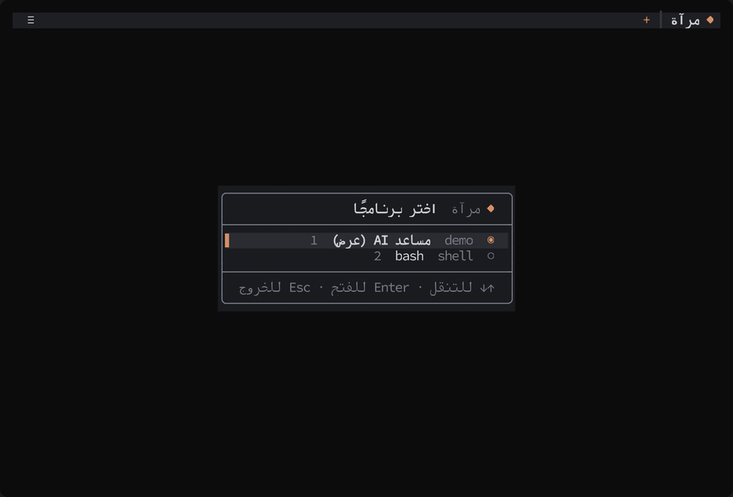
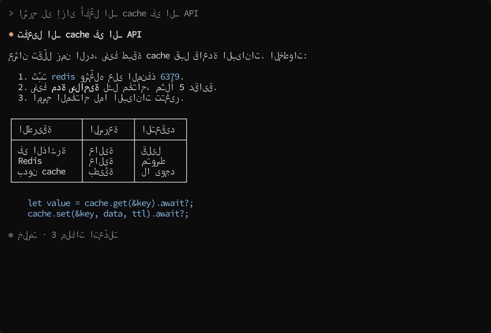
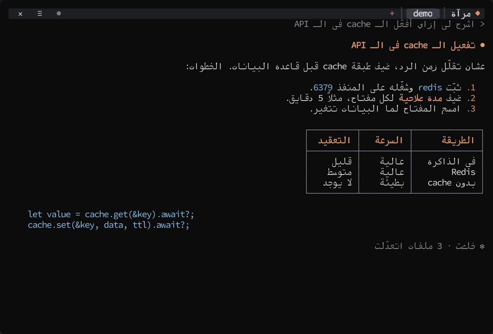
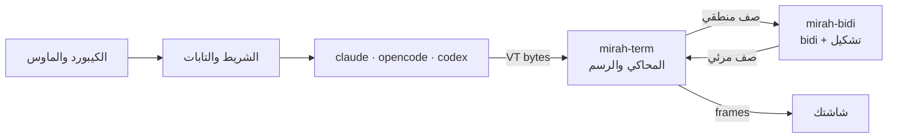

<div dir="rtl">

# مرآة (mirah)

[English](README.en.md)

[](https://github.com/Khaymah/mirah/actions/workflows/ci.yml)
[](https://github.com/Khaymah/mirah/releases/latest)
[](LICENSE)

**مرآة** أداة مفتوحة المصدر من [خيمة (Khaymah)](https://github.com/Khaymah). بتشغّل Claude Code وOpenCode وCodex وGemini، وأي برنامج terminal تاني، وبتصلّح العربي قبل ما يوصل لشاشتك:
- الكلام بيتقري من اليمين، والحروف موصولة.
- الفقرات والجداول بتتحاذى يمين.
- وفوق البرنامج شريط بالعربي فيه التابات والإعدادات.

<p align="center"></p>

<p align="center"><a href="docs/images/tour.gif">جولة كاملة في 46 ثانية: التابات، والإعدادات، وعارض Markdown</a></p>

| من غير مرآة | مع مرآة |
|---|---|
|  |  |

> الصورتين من نفس الرد، بعد ما اتعرض في ترمنال عادي وفي مرآة. الرد مكتوب في [`docs/demo`](docs/demo)، والصور اتعملت من تشغيل حقيقي لمرآة.

## التثبيت

**ويندوز (PowerShell):**

```powershell
powershell -ExecutionPolicy Bypass -c "irm https://github.com/Khaymah/mirah/releases/latest/download/mirah-installer.ps1 | iex"
```

**macOS وLinux:**

```bash
curl --proto '=https' --tlsv1.2 -LsSf https://github.com/Khaymah/mirah/releases/latest/download/mirah-installer.sh | sh
```

- الأمر بيحط مرآة في `~/.mirah/bin` وبيضيفها للـ PATH، فافتح ترمنال جديد بعده.
- بعد كده `mirah update` بيجيب أي نسخة أحدث.
- ويندوز ممكن يطلّع تحذير SmartScreen أول مرة، لأن الملف مش موقّع بشهادة.
- عايز تتأكد من الملف بإيدك، أو تبني من الكود؟ شوف [تثبيت بإيدك](#تثبيت-بإيدك).

**الخط:** مرآة مابتغيّرش خط الترمنال، فاختار خط monospace فيه عربي:
- **[Kawkab Mono](http://makkuk.com/kawkab-mono):** معمول للعربي في الترمنال.
- **Cascadia Mono:** جاي مع Windows Terminal، وفيه عربي من نسخة 2106.17.
- **DejaVu Sans Mono.**

## أول استخدام

```bash
mirah
```

مرآة بتدوّر على البرامج المتسطّبة عندك، وبتفتح شاشة تختار منها:
- **البرامج اللي بتدوّر عليها:** Claude Code، وOpenCode، وCodex، وGemini، وQwen، وAider، وCrush، وCursor Agent، وAmp، وCopilot، وGoose، وفي الآخر الـ shell بتاعك.
- **آخر برنامج استخدمته** بيبقى هو المختار.
- **تحت البرامج** بتلاقي آخر الجلسات اللي تقدر تكمّلها، وآخر ملفات Markdown والتسجيلات في الفولدر.
- **التنقل:** بالأسهم وEnter، أو برقم السطر على طول.

ولو عايز برنامج بعينه من غير الشاشة دي:

```bash
mirah claude
mirah opencode --model gpt-5
```

> على ويندوز: البرامج اللي متسطّبة بـ npm (زي `codex` و`gemini`) بتشتغل عادي. ولو شغّال من الفولدر اللي فيه `mirah.exe` ومش حاطّه في الـ PATH، PowerShell محتاج `.\mirah.exe`.

> مرآة للبرامج اللي بتشتغل **جوه** الترمنال. البرامج اللي بتفتح نافذة لوحدها، زي `notepad` أو `code` بتاع VS Code:
> - على ويندوز، مرآة بتعرف من الـ exe إنه بيفتح نافذة، وبتقولك كده من غير ما تشغّله.
> - ولو برنامج خلص في أقل من 3 ثواني من غير ما يعرض حاجة، مرآة بتكتبلك السبب وهي خارجة، ومابتحفظش له جلسة.

## بتعمل إيه

**العربي:**
- **بترتّب كل سطر** بـ [UAX #9](https://unicode.org/reports/tr9/). الإنجليزي والأرقام والمسارات بيفضلوا من الشمال لليمين جوه الكلام العربي.
- **بتوصّل الحروف**:
  - ومعاها "لا" والحروف الفارسية (پ چ ژ گ ک ی).
  - والحركات بتفضل على حرفها.
  - أو بتسيب الترمنال يوصّلها، زي Windows Terminal.
- **بتحاذي الكلام يمين:** الفقرات، والعناوين، والقوايم بعلامتها، والكلام جوه الصناديق. والكود وسطر الأوامر بيفضلوا مكانهم.
- **بتعكس الجداول**، فأول عمود بيبقى على اليمين، والجدول العربي بيروح على يمين الشاشة.
- **بتلوّن الماركداون** في الشاشات اللي فيها عربي: العناوين، والكلام العريض، وعناوين الجداول.
- **بتفهم الشاشات المقسومة**، زي الـ sidebar في OpenCode.
- **بترجّع ترتيب البرنامج اللي بيقلب العربي بنفسه**، زي Claude Code على ويندوز.
- **الماوس والنسخ:**
  - الضغطة بتوصل للبرنامج في مكان الكلمة اللي انت شايفها.
  - واللي البرنامج بينسخه بيوصل للحافظة بالترتيب الصح.

**الشغل:**
- **تابات:** تفتح أكتر من برنامج جنب بعض، من غير ما تخرج.
- **شريط بالعربي فيه الإعدادات:** كل إعداد بيتغير وانت شغال، وبيتحفظ في `config.toml`.
- **جلسات ليها ID:** تكمّل أي محادثة بعدين بـ `mirah resume`.
- **عارض ملفات Markdown:** تقرا أي ملف `.md` بالعربي ومن اليمين، وتحفظ نسخة منه في التنزيلات.
- **تشغيل التسجيلات:** أي تسجيل `.vt` بيتعرض جوه مرآة زي ما كان البرنامج شغال.
- **تحديث بأمر واحد**، ومعاه التأكد من الـ SHA-256.

## الشريط والتابات

أول سطر في الشاشة بتاع مرآة، والبرنامج بيشتغل في الباقي:

```
 ✕  ≡  ●                                 + ┃ opencode • ┃▐ claude ▌┃ مرآة ◆
```

| العنصر | بيعمل إيه |
|---|---|
| التاب | كل تاب فيه برنامج شغال، والمفتوح عليه خلفية. التابات التانية بتفضل شغالة، ولو فيها حاجة جديدة بيظهر عليها `•` |
| `+` | تاب جديد، من شاشة الاختيار |
| `●` | يبدأ يسجّل التاب ده. وهو شغال بيبقى `■` أحمر ومعاه المدة، ولو دست عليه تاني بيقف |
| `↻` | بيظهر لو فيه نسخة جديدة، والضغط عليه بيسطّبها للمرة الجاية |
| `≡` | الإعدادات |
| `✕` | بيقفل التاب ده بعد ما يسألك. ولما آخر تاب يتقفل، مرآة بتخرج |

**الكيبورد:**

| الاختصار | بيعمل إيه |
|---|---|
| `Ctrl+]` | يفتح الشريط: الأسهم بتتنقل، وEnter بيختار، وEsc بيرجعك للبرنامج. وبيشتغل في شاشة الاختيار كمان |
| `Ctrl+]` وبعدين `1` لـ `9` | يروح للتاب رقم كذا |
| `Ctrl+]` وبعدين `t` | تاب جديد |
| `Ctrl+]` وبعدين `q` | يقفل مرآة وكل البرامج اللي جواها. البرامج بتاخد لحد ثانية تقريباً عشان تحفظ شغلها |
| `Ctrl+]` مرتين | يبعت `Ctrl+]` للبرنامج نفسه |

> الحروف بتشتغل والكيبورد على العربي كمان: `t` هي `ف`، و`q` هي `ض`، والأرقام العربي `١`–`٩`.

**الماوس:** الشريط والتابات و✕ بيشتغلوا بالماوس مع أي برنامج.
- **التحديد العادي** في البرامج اللي مش طالبة الماوس (زي Codex والـ shell) بيبقى بـ `Shift` + سحب.
- **عجلة الماوس** في البرامج دي بتتحول لأسهم فوق وتحت.
- **عايز التحديد من غير `Shift`؟** اقفل "الماوس للشريط دائمًا" من الخيارات المتقدّمة. ساعتها الشريط بيشتغل بالماوس مع البرامج اللي طالبة الماوس بس، زي Claude Code وOpenCode.

## الإعدادات

`≡` بيفتح قايمة. كل إعداد بيتغير وانت شغال، وتقدر تطبّقه على كل البرامج أو على البرنامج ده بس:

| الإعداد | الاختيارات | بيعمل إيه |
|---|---|---|
| المحاذاة | كل النص · العربي فقط · إيقاف | يحاذي الكلام يمين، عربي وإنجليزي، أو العربي بس |
| تلوين Markdown | تشغيل · إيقاف | يلوّن العناوين، وعلامات القوايم، والكلام العريض، وعناوين الجداول. في الشاشات اللي فيها عربي بس، ومابيلمسش الكلام الملوّن أصلاً |
| عكس الجداول | تشغيل · إيقاف | أول عمود على اليمين، والجدول العربي على يمين الشاشة |
| تسجيل كل جلسة | تشغيل · إيقاف | كل تاب جديد بيتسجّل في فولدر الجلسة بتاعته |
| النسخ عند التحديد | تشغيل · إيقاف | Claude Code بينسخ أي حاجة تحددها، ومرآة بترجّع ترتيب العربي في النسخة. لو قفلته، التحديد مابيغيّرش الحافظة |
| البحث عن تحديثات | تشغيل · إيقاف | يدوّر على نسخة جديدة في الخلفية |
| **متقدّم:** وصل الحروف | تلقائي · مرآة · الطرفية | مين اللي يوصّل الحروف. Windows Terminal بيوصّلها بنفسه |
| **متقدّم:** ترتيب نص البرنامج | تلقائي · منطقي · مرئي | "مرئي" للبرامج اللي بتقلب العربي بنفسها، زي Claude Code على ويندوز |
| **متقدّم:** تحويل نقرات الماوس | تشغيل · إيقاف | الضغطة توصل للبرنامج في مكان الكلمة اللي انت شايفها |
| **متقدّم:** الماوس للشريط دائمًا | تشغيل · إيقاف | الشريط يشتغل بالماوس مع أي برنامج. لو قفلته، التحديد العادي بيرجع من غير `Shift` |

### ملف الإعدادات

القايمة بتحفظ في `config.toml`: في `%APPDATA%\mirah\` على ويندوز، وفي `~/.config/mirah/` على الباقي. وتقدر تعدّله بإيدك، والتعليقات اللي بتكتبها بتفضل زي ما هي:

```toml
align = "prose"
record = true

[programs.opencode]
align = "arabic"

[[agents]]
name = "work"
title = "Claude (الشغل)"
command = "claude-work"
resume = ["--continue"]
```

- **`[programs.X]`:** إعدادات لبرنامج واحد.
- **`[[agents]]`:** بيضيف برنامج لشاشة الاختيار.
- **مين بيكسب:** متغيرات `MIRAH_*` الأول، وبعدين قسم البرنامج، وبعدين الإعدادات العامة.
- **لو الملف بايظ أو مش مقري:** مرآة بتشتغل بالافتراضي، ومابتكتبش فوقه.

### متغيرات البيئة

| المتغير | القيم | بيعمل إيه |
|---|---|---|
| `MIRAH_ALIGN` | `prose`، `arabic`، `off` | زي إعداد المحاذاة |
| `MIRAH_SHAPING` | `full`، `plain` | `full`: مرآة بتوصّل الحروف. `plain`: الترمنال بيوصّلها |
| `MIRAH_INPUT` | `logical`، `visual` | زي "ترتيب نص البرنامج" |
| `MIRAH_BAR` | `0` | يخفي الشريط، فالبرنامج ياخد الشاشة كلها |
| `MIRAH_NO_UPDATE_CHECK` | `1` | يقفل البحث عن تحديثات |
| `MIRAH_CONPTY` | `system` | على ويندوز: يستخدم ConPTY اللي جوه ويندوز بدل النسخة الأحدث اللي جوه مرآة |
| `MIRAH_RECORD` | مسار ملف | يسجّل output البرنامج اللي في أول تاب في الملف ده |
| `MIRAH_LOG` | `debug` | يكتب log في `%LOCALAPPDATA%\mirah\mirah.log` أو `~/.local/state/mirah/mirah.log` |

## الجلسات والتسجيل

كل تاب جلسة ليها ID قصير، زي `1106-0457-k3f2`:

```bash
mirah sessions
mirah resume 1106-0457-k3f2
mirah --record claude
```

- **`mirah sessions`:** بيعرض آخر الجلسات ومكان فولدرها.
- **`mirah resume <ID>`:**
  - بيكمّل نفس المحادثة: بيفتح نفس البرنامج في نفس الفولدر، بطريقة البرنامج نفسه (`claude --continue`، و`opencode --continue`، و`codex resume --last`، و`gemini --resume`).
  - ومن غير ID بيكمّل آخر جلسة.
- **`mirah --record`:** بيسجّل الجلسة دي ومعاها log كامل، ولما تخرج بيكتبلك الـ ID.
- **التنضيف:** مرآة بتحتفظ بآخر 50 جلسة، أو آخر 14 يوم لو أكتر.

**الجلسات بتتحفظ فين:**
- **الافتراضي:** فولدر `sessions` جنب `mirah.exe`.
- **لو مرآة متسطّبة بالـ installer:** `~/.mirah/sessions`.
- **لو مش قادرة تكتب هناك:** `%LOCALAPPDATA%\mirah\sessions\` على ويندوز، أو `~/.local/state/mirah/sessions/`.
- **مكان تاني تختاره انت:** `sessions_dir = "D:/mirah/sessions"` في `config.toml`، ومرآة مابتغيّرش فيه حاجة.

في فولدر الجلسات `.gitignore`، عشان التسجيلات ماتتضافش لـ git بالغلط. وعلى لينكس وماك، محدش بيقدر يفتح الفولدر غيرك.

جوه فولدر كل جلسة:
- **`session.toml`:** البرنامج، والأمر، والفولدر، وإمتى بدأت وإمتى خلصت. ده بيتعمل دايماً عشان `resume`.
- **`output.vt`:** التسجيل، لو التسجيل كان شغال.
- **`mirah.log`:** الـ log، لو `--record` كان شغال.

> **التسجيل ممكن يبقى فيه مسارات من جهازك، أو أي حاجة ظهرت على الشاشة.** راجعه قبل ما تبعته مع أي bug report.

## عارض ملفات Markdown

```bash
mirah view خطة.md
```

أو اختار الملف من شاشة الاختيار، تحت "ملفات للعرض". الملف بيتفتح في تاب:
- **العناوين، والقوايم، والاقتباسات** على اليمين.
- **الجداول** بإطار، ومعكوسة، وعلى يمين الشاشة.
- **الكود** على الشمال، ومن الشمال لليمين حتى لو فيه عربي.
- **السطور الطويلة** بتلف على عرض الشاشة.

| الزرار | بيعمل إيه |
|---|---|
| `↑` `↓` أو عجلة الماوس | تمرير |
| `PgUp` `PgDn` أو المسافة | صفحة كاملة |
| `Home` `End` | أول الملف وآخره |
| `S` (أو `س`) | يحفظ نسخة في التنزيلات. ولو فيه ملف بنفس الاسم، بيسمّيها `خطة (2).md` |
| `Esc` أو `Q` (أو `ض`) | يقفل التاب |

## تشغيل التسجيلات

```bash
mirah play claude-session-1.vt
mirah play 1106-0457-k3f2
```

بيشغّل تسجيل `.vt`، أو تسجيل جلسة بالـ ID بتاعها، في تاب، وكأن البرنامج شغال قدامك.

| الزرار | بيعمل إيه |
|---|---|
| المسافة | إيقاف مؤقت وتكملة |
| `→` | أسرع ×8 |
| `End` | لآخر التسجيل على طول |
| `R` | من الأول |
| `Esc` أو `Q` | يقفل التاب |

> التسجيل مابيحفظش مقاس الشاشة، فبيتعرض صح لما النافذة تبقى بنفس المقاس اللي اتسجّل عليه.

## التحديث

```bash
mirah update
```

- **بيدوّر على آخر نسخة في الـ Releases:**
  - لو انت على نسخة مستقرة، بيجيب النسخ المستقرة بس.
  - ولو على نسخة alpha، بيجيب أحدث حاجة.
- **قبل ما يبدّل `mirah`،** بيتأكد إن الملف اللي نزل مطابق للـ SHA-256 بتاعه. ولو مش مطابق، مفيش حاجة بتتغير.
- **الشريط بيدوّر لوحده في الخلفية**، ولو لقى نسخة جديدة بيظهر `↻`.
- **محتاج `curl` و`tar`**، وهما موجودين على ويندوز 10 و11 وmacOS وLinux.

## الترمنالات

| الترمنال | عنده bidi | بيقفله بـ BDSM | مرآة بتعمل إيه |
|---|---|---|---|
| Windows Terminal | ❌ | مش محتاج | بترتّب، والترمنال بيوصّل الحروف. ومرآة بتشيل جواها ConPTY أحدث |
| GNOME Terminal / VTE | ✅ | ✅ | بتقفل الـ bidi بتاعه وترتّب هي |
| iTerm2 3.7 | ✅ | ✅ | بتقفل الـ bidi بتاعه وترتّب هي |
| Kitty · Alacritty · Ghostty | ❌ | مش محتاج | بترتّب وتوصّل الحروف |
| VS Code · Cursor (xterm.js) | ❌ | مش محتاج | بترتّب وتوصّل الحروف |
| Konsole | ✅ | ❌ | ⚠️ النص هيتعكس مرتين. اقفل الـ bidi من إعدادات Konsole |

> الشغل الأساسي اتجرّب على Windows Terminal. باقي الجدول جاي من التوثيق بتاع كل ترمنال. لو جرّبت ترمنال، [قولنا النتيجة](https://github.com/Khaymah/mirah/issues/new/choose).

## الحدود المعروفة

- **تحديد الترمنال نفسه:** لو حددت بالماوس في برنامج مش طالب الماوس، الترمنال هو اللي بينسخ اللي على الشاشة، يعني بالترتيب المرئي. لكن النسخ اللي البرنامج بيعمله بنفسه (زي Claude Code) بيوصل صح.
- **تحديد أكتر من حرف جوه كلمة عربي** (زي visual mode في vim) بيقطّع الكلمة. التفاصيل في [Plan/FakeCursor.md](Plan/FakeCursor.md).
- **المحاذاة بتخمّن** إيه الكلام وإيه الكود من الألوان والرموز. لو لقيت سطر عربي فاضل على الشمال، [ابعتلنا](https://github.com/Khaymah/mirah/issues/new/choose) screenshot أو تسجيل.
- **عارض Markdown** مابيعرضش الصور، وبيكتب مكانها رابطها. والـ HTML اللي جوه الملف بيظهر كنص.
- **الـ scrollback:** مرآة شغالة على الـ alternate screen، فالكلام اللي طلع برا الشاشة من فوق مابيرجعش بعجلة الماوس.
- **ConPTY على ويندوز:** مرآة بتفكّ نسخة أحدث (من Microsoft، بترخيص MIT) في `%LOCALAPPDATA%\mirah\conpty\` أول مرة. التفاصيل في [ADR-0004](Plan/ADR/0004-bundle-conpty-on-windows.md).

## تثبيت بإيدك

### ومعاه التأكد من الملف

installer الـ PowerShell مابيتأكدش من الـ SHA-256 بنفسه. لو عايز تتأكد بإيدك:

```powershell
curl.exe -LO https://github.com/Khaymah/mirah/releases/latest/download/mirah-x86_64-pc-windows-msvc.zip
curl.exe -LO https://github.com/Khaymah/mirah/releases/latest/download/mirah-x86_64-pc-windows-msvc.zip.sha256
(Get-FileHash mirah-x86_64-pc-windows-msvc.zip -Algorithm SHA256).Hash -eq (Get-Content mirah-x86_64-pc-windows-msvc.zip.sha256).Split(" ")[0]
Expand-Archive mirah-x86_64-pc-windows-msvc.zip -DestinationPath "$HOME\.mirah\bin"
```

- **الأمر التالت لازم يطبع `True`.**
- **ضيف `%USERPROFILE%\.mirah\bin` للـ PATH.**
- **لو جهازك ARM:** استخدم `aarch64-pc-windows-msvc`.
- **على macOS وLinux:** نفس الخطوات بالملف المناسب، زي `mirah-aarch64-apple-darwin.tar.xz` أو `mirah-x86_64-unknown-linux-gnu.tar.xz`.

**إثبات المصدر:** كل ملف معاه GitHub attestation بيثبت إنه اتبنى من الريبو ده في GitHub Actions:

```bash
gh attestation verify mirah-x86_64-pc-windows-msvc.zip --repo Khaymah/mirah
```

### من الكود

محتاج Rust 1.97 أو أحدث:

```bash
git clone https://github.com/Khaymah/mirah
cd mirah
cargo build --release
```

الـ binary هيطلع في `target/release/mirah`.

## إزاي بتشتغل



| Crate | المسؤولية |
|---|---|
| [`mirah-bidi`](crates/mirah-bidi) | الترتيب، وتوصيل الحروف، وترجيع الترتيب. من غير I/O، وبيتعمله build لـ WebAssembly |
| [`mirah-term`](crates/mirah-term) | المحاكي: يدخله bytes ويطلّع frames. تصنيف السطور، والمحاذاة، والجداول، والشاشات المقسومة، والنسخ |
| [`mirah`](crates/mirah) | البرنامج نفسه: التابات، والشريط، والإعدادات، والجلسات، والتحديث، والـ pty |

القرارات وأسبابها في [`Plan/ADR`](Plan/ADR)، والمعمارية في [`Plan/Architecture.md`](Plan/Architecture.md).

## المجتمع

مرآة من [خيمة (Khaymah)](https://github.com/Khaymah). تعالى اتكلم معانا، وقولنا رأيك، أو اسأل:

- **GitHub:** https://github.com/Khaymah
- **النقاشات على قبيلة:** https://qabilah.com/communities/Khaymah
- **جروب الواتساب:** https://chat.whatsapp.com/GIixmbibIix8PyUzFBbNoq

## المساهمة

أي مساهمة مرحّب بيها، حتى من غير كود: سطر عربي بيظهر غلط بيتضاف للـ corpus في سطرين. التفاصيل في [CONTRIBUTING.md](CONTRIBUTING.md).

- **لقيت مشكلة؟** [افتح issue](https://github.com/Khaymah/mirah/issues/new/choose).
- **ثغرة أمنية؟** ماتفتحش issue عام، واتبع [SECURITY.md](SECURITY.md).

## الترخيص

MIT · راجع [LICENSE](LICENSE)

</div>
