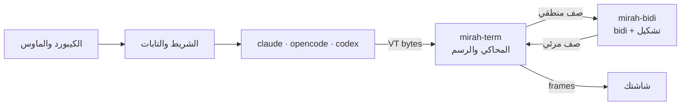

<div dir="rtl">

# مرآة (mirah)

[English](README.en.md)

**مرآة** بتشغّل Claude Code وOpenCode وCodex وGemini، وأي برنامج terminal تاني، جوه نافذة واحدة، وبتصلّح العربي قبل ما يوصل لشاشتك: الكلام بيتقري من اليمين، والحروف موصولة، والفقرات والجداول متحاذية يمين. وفوق البرنامج شريط بالعربي فيه التابات، والإعدادات، والتسجيل.

```bash
mirah
```

> ⚠️ **المشروع لسه alpha.** اتجرّب على جلسات حقيقية متسجّلة لـ Claude Code وOpenCode، وعلى ويندوز ولينكس، بس لسه بيتغير كل يوم. شوف [الحدود الحالية](#الحدود-الحالية).

## المشكلة

أغلب الترمنالات بترسم الحروف من الشمال لليمين، خلية خلية. فالكلام العربي بيظهر **مقلوب** و**حروفه مقطّعة**، والجداول والقوايم بتبقى على الشمال:

```
اللي البرنامج كتبه:   افتح الملف src/main.rs في السطر 42
اللي بيظهر عندك:      ا ف ت ح  ا ل م ل ف  src/main.rs  ف ي  ...   (مقلوب ومقطّع)
اللي مرآة بترسمه:     42 ﺮﻄﺴﻟﺍ ﻲﻓ src/main.rs ﻒﻠﻤﻟﺍ ﺢﺘﻓﺍ   (بيتقري صح من اليمين)
```

الحلول الموجودة كل واحد منها بيصلّح أداة واحدة أو ترمنال واحد. مرآة بتشتغل بين البرنامج والترمنال، فبتنفع مع أي برنامج، ومن غير ما تلمس كوده.

## بتعمل إيه

**العربي:**
- **بترتّب كل سطر** بـ [UAX #9](https://unicode.org/reports/tr9/). الإنجليزي والأرقام والمسارات بيفضلوا من الشمال لليمين جوه الكلام العربي.
- **بتوصّل الحروف**، ومعاها "لا" والحروف الفارسية (پ چ ژ گ ک ی)، والحركات بتفضل على حرفها. أو بتسيب الترمنال يوصّلها، زي Windows Terminal.
- **بتحاذي الكلام يمين:** الفقرات، والعناوين، والقوايم بعلامتها، والكلام جوه الصناديق. والكود وسطر الأوامر بيفضلوا مكانهم.
- **بتعكس الجداول**، فأول عمود بيبقى على اليمين.
- **بتفهم الشاشات المقسومة**، زي الـ sidebar في OpenCode، وبتتعامل مع كل جزء لوحده.
- **بترجّع ترتيب البرنامج اللي بيقلب العربي بنفسه**، زي Claude Code على ويندوز.
- **الماوس والنسخ:** الضغطة بتوصل للبرنامج في مكان الكلمة اللي انت شايفها. واللي البرنامج بينسخه بيوصل للحافظة بالترتيب الصح.

**الشغل:**
- **شاشة اختيار:** `mirah` لوحده بيدوّر على البرامج المتسطّبة عندك، وانت تختار.
- **تابات:** تفتح أكتر من برنامج جنب بعض، من غير ما تخرج.
- **شريط بالعربي فيه الإعدادات:** كل إعداد بيتغير وانت شغال، وبيتحفظ في `config.toml`.
- **جلسات ليها ID:** تكمّل أي محادثة بعدين بـ `mirah resume`، والتسجيلات والـ logs في مكان واحد منظم.
- **عارض ملفات Markdown:** تقرا أي ملف `.md` بالعربي ومن اليمين، وتحفظ نسخة منه في التنزيلات.
- **تشغيل التسجيلات:** أي تسجيل `.vt` بيتعرض جوه مرآة زي ما كان البرنامج شغال.
- **تحديث بأمر واحد**، ومعاه التأكد من الـ SHA-256.

## التثبيت

### بأمر واحد

**ويندوز (PowerShell):**

```powershell
powershell -ExecutionPolicy Bypass -c "irm https://github.com/Khaymah/mirah/releases/download/v0.4.0-alpha.7/mirah-installer.ps1 | iex"
```

**macOS وLinux:**

```bash
curl --proto '=https' --tlsv1.2 -LsSf https://github.com/Khaymah/mirah/releases/download/v0.4.0-alpha.7/mirah-installer.sh | sh
```

الأمر بيحط مرآة في `~/.mirah/bin` وبيضيفها للـ PATH، فافتح ترمنال جديد بعده. وبعد كده `mirah update` بيجيب أي نسخة أحدث.

> - كل النسخ لسه alpha، وGitHub مابيعتبرهاش "latest"، فالأمر لازم يبقى لنسخة بعينها. وكل release فيه الأمر بتاعه.
> - ويندوز ممكن يطلّع تحذير SmartScreen أول مرة، لأن الملف لسه مش موقّع.

### بإيدك، ومعاه التأكد من الملف

installer الـ PowerShell مابيتأكدش من الـ SHA-256 بنفسه. لو عايز تتأكد بإيدك:

```powershell
curl.exe -LO https://github.com/Khaymah/mirah/releases/download/v0.4.0-alpha.7/mirah-x86_64-pc-windows-msvc.zip
curl.exe -LO https://github.com/Khaymah/mirah/releases/download/v0.4.0-alpha.7/mirah-x86_64-pc-windows-msvc.zip.sha256
(Get-FileHash mirah-x86_64-pc-windows-msvc.zip -Algorithm SHA256).Hash -eq (Get-Content mirah-x86_64-pc-windows-msvc.zip.sha256).Split(" ")[0]
Expand-Archive mirah-x86_64-pc-windows-msvc.zip -DestinationPath "$HOME\.mirah\bin"
```

- **الأمر التالت لازم يطبع `True`:** ده معناه إن الملف اللي نزل هو نفسه اللي الـ release بناه.
- **ضيف `%USERPROFILE%\.mirah\bin` للـ PATH.**
- **لو جهازك ARM:** استخدم `aarch64-pc-windows-msvc`.
- **على macOS وLinux:** نفس الخطوات بالملف المناسب لجهازك، زي `mirah-aarch64-apple-darwin.tar.xz` أو `mirah-x86_64-unknown-linux-gnu.tar.xz`.

**إثبات المصدر:** كل ملف معاه GitHub attestation بيثبت إنه اتبنى من الريبو ده في GitHub Actions. ولو عندك [GitHub CLI](https://cli.github.com):

```bash
gh attestation verify mirah-x86_64-pc-windows-msvc.zip --repo Khaymah/mirah
```

### من الكود

محتاج Rust 1.97 أو أحدث:

```bash
git clone https://github.com/Khaymah/mirah
cd mirah
cargo build --release
```

الـ binary هيطلع في `target/release/mirah`.

### الخط

مرآة مابتغيّرش خط الترمنال، فاختار خط monospace فيه عربي:

- **Kawkab Mono:** خط مخصوص للعربي في الترمنال.
- **Cascadia Mono:** جاي مع Windows Terminal، وفيه عربي من نسخة 2106.17.
- **DejaVu Sans Mono.**

## أول استخدام

```bash
mirah
```

مرآة بتدوّر على البرامج المتسطّبة عندك: Claude Code، وOpenCode، وCodex، وGemini، وQwen، وAider، وCrush، وCursor Agent، وAmp، وCopilot، وGoose، وفي الآخر الـ shell بتاعك. وبتفتح شاشة تختار منها:

- **آخر برنامج استخدمته** بيبقى هو المختار.
- **تحت البرامج** آخر الجلسات اللي تقدر تكمّلها، وآخر ملفات Markdown والتسجيلات في الفولدر.
- **التنقل:** الأسهم، وEnter، أو رقم السطر على طول.

ولو عايز برنامج بعينه من غير الشاشة دي:

```bash
mirah claude
mirah opencode --model gpt-5
```

**على ويندوز:**
- البرامج اللي متسطّبة بـ npm (زي `opencode` و`gemini`) بتشتغل عادي، لأن مرآة بتدوّر على الـ `.cmd` بتاعها.
- ولو شغّال من الفولدر اللي فيه `mirah.exe` ومش حاطّه في الـ PATH، PowerShell محتاج `.\mirah.exe`.

## عارض ملفات Markdown

```bash
mirah view خطة.md
```

أو اختار الملف من شاشة الاختيار، تحت "ملفات للعرض". الملف بيتفتح في تاب:

- **العناوين، والقوايم، والاقتباسات** على اليمين، والعلامة على يمين السطر.
- **الجداول** بإطار، ومعكوسة، وعلى يمين الشاشة.
- **الكود** على الشمال، وبيتقري من الشمال لليمين حتى لو فيه عربي.
- **السطور الطويلة** بتلف على عرض الشاشة.

| الزرار | بيعمل إيه |
|---|---|
| `↑` `↓` أو عجلة الماوس | تمرير |
| `PgUp` `PgDn` أو المسافة | صفحة كاملة |
| `Home` `End` | أول الملف وآخره |
| `S` | يحفظ نسخة في التنزيلات (`Downloads`)، ولو فيه ملف بنفس الاسم بيسمّيها `خطة (2).md` |
| `Esc` أو `Q` | يقفل التاب |

> الحروف بتشتغل والكيبورد على العربي كمان: `S` هي `س`، و`Q` هي `ض`. ونفس الكلام في الشريط: `Ctrl+]` وبعدين `t` أو `ف`، والأرقام العربي `١`–`٩`.

## تشغيل التسجيلات

```bash
mirah play claude-session-1.vt
mirah play 1106-0457-k3f2
```

بيشغّل تسجيل `.vt`، أو تسجيل جلسة بالـ ID بتاعها، في تاب، وكأن البرنامج شغال قدامك: الكلام من اليمين، والجداول معكوسة. والتسجيلات اللي في الفولدر بتظهر كمان في شاشة الاختيار تحت "ملفات للعرض".

| الزرار | بيعمل إيه |
|---|---|
| المسافة | إيقاف مؤقت وتكملة |
| `→` | أسرع ×8 |
| `End` | لآخر التسجيل على طول |
| `R` | من الأول |
| `Esc` أو `Q` | يقفل التاب |

> التسجيل مابيحفظش مقاس الشاشة، فبيتعرض صح لما النافذة تبقى بنفس المقاس اللي اتسجّل عليه.

## الشريط والتابات

أول سطر في الشاشة بتاع مرآة، والبرنامج بيشتغل في الباقي:

```
 ✕  ≡  ●                                 + ┃ opencode • ┃▐ claude ▌┃ مرآة ◆
```

| العنصر | بيعمل إيه |
|---|---|
| التاب | كل تاب فيه برنامج شغال، والمفتوح عليه خلفية. التابات التانية بتفضل شغالة، ولو فيها حاجة جديدة بيظهر عليها `•` |
| `+` | تاب جديد، من شاشة الاختيار |
| `●` | يبدأ يسجّل التاب ده. وهو شغال بيبقى `■` ومعاه المدة، ولما تدوس تاني بيقف، ولو شغلته تاني بيكمّل في نفس الملف |
| `↻` | بيظهر لو فيه نسخة جديدة، والضغط عليه بيسطّبها للمرة الجاية |
| `≡` | الإعدادات |
| `✕` | بيقفل التاب ده بعد ما يسألك. ولما آخر تاب يتقفل، مرآة بتخرج |

**الكيبورد:**

| الاختصار | بيعمل إيه |
|---|---|
| `Ctrl+]` | يفتح الشريط: الأسهم بتتنقل، والوصول لتاب بيفتحه، وEnter بيختار، وEsc بيرجعك للبرنامج |
| `Ctrl+]` وبعدين `1` لـ `9` | يروح للتاب رقم كذا |
| `Ctrl+]` وبعدين `t` | تاب جديد |
| `Ctrl+]` وبعدين `q` | يقفل مرآة وكل البرامج اللي جواها، حتى لو البرنامج مش بيرد على الزراير |
| `Ctrl+]` مرتين | يبعت `Ctrl+]` للبرنامج نفسه |

**الماوس:** الشريط والتابات و✕ بيشتغلوا بالماوس مع أي برنامج، لأن مرآة بتطلب الماوس من الترمنال دايماً.
- **التحديد العادي** في البرامج اللي مش طالبة الماوس (زي Codex والـ shell) بقى بـ `Shift` + سحب، زي أي برنامج بيستخدم الماوس في Windows Terminal.
- **عجلة الماوس** في البرامج دي بتتحول لأسهم فوق وتحت، فالتمرير بيفضل شغال.
- **لو عايز التحديد العادي من غير `Shift`:** اقفل "الماوس للشريط دائمًا" من الخيارات المتقدّمة. ساعتها الشريط بيشتغل بالماوس بس مع البرامج اللي طالبة الماوس، زي Claude Code وOpenCode.

## الإعدادات

`≡` بيفتح قايمة، وكل إعداد بيتغير وانت شغال، على كل البرامج أو على البرنامج ده بس:

| الإعداد | الاختيارات | بيعمل إيه |
|---|---|---|
| المحاذاة | كل النص · العربي فقط · إيقاف | يحاذي الكلام يمين، عربي وإنجليزي، أو العربي بس |
| تلوين Markdown | تشغيل · إيقاف | العناوين، وعلامات القوايم، والكلمات العريضة، وصف عناوين الجدول بلون مميز، وإطار الجداول وخطوط `---` أهدى، زي opencode. بيلوّن الكلام اللي بلون الكلام العادي بس |
| عكس الجداول | تشغيل · إيقاف | أول عمود على اليمين، والجدول العربي بيروح على يمين الشاشة |
| تسجيل كل جلسة | تشغيل · إيقاف | كل تاب جديد بيتسجّل في فولدر الجلسة بتاعته |
| النسخ عند التحديد | تشغيل · إيقاف | Claude Code بينسخ أي حاجة تحددها لوحده، ومرآة بترجّع ترتيب العربي في النسخ (وعلى ويندوز بتحط النص الصح في الحافظة بنفسها). لو قفلته، التحديد مابيغيّرش الحافظة |
| البحث عن تحديثات | تشغيل · إيقاف | يدوّر على نسخة جديدة في الخلفية |
| **خيارات متقدّمة:** وصل الحروف | تلقائي · مرآة · الطرفية | مين اللي يوصّل الحروف. Windows Terminal بيوصّلها بنفسه |
| **خيارات متقدّمة:** ترتيب نص البرنامج | تلقائي · منطقي · مرئي | "مرئي" للبرامج اللي بتقلب العربي بنفسها، زي Claude Code على ويندوز |
| **خيارات متقدّمة:** تحويل نقرات الماوس | تشغيل · إيقاف | الضغطة توصل للبرنامج في مكان الكلمة اللي انت شايفها |
| **خيارات متقدّمة:** الماوس للشريط دائمًا | تشغيل · إيقاف | الشريط يشتغل بالماوس مع أي برنامج. لو قفلته، التحديد العادي بيرجع من غير `Shift` |

### ملف الإعدادات

القايمة بتحفظ في `config.toml`: في `%APPDATA%\mirah\` على ويندوز، وفي `~/.config/mirah/` على الباقي. وتقدر تعدّله بإيدك، والتعليقات اللي بتكتبها بتفضل:

```toml
align = "prose"
record = true

[programs.opencode]
align = "arabic"

[[agents]]
name = "work"
title = "Claude (الشغل)"
command = "claude-work"
resume = ["--continue"]
```

- **`[programs.X]`** إعدادات لبرنامج واحد.
- **`[[agents]]`** بيضيف برنامج لشاشة الاختيار، حتى لو مش في القايمة اللي مرآة بتدوّر عليها.
- **مين بيكسب:** متغيرات `MIRAH_*` الأول، وبعدين قسم البرنامج، وبعدين الإعدادات العامة.
- **لو الملف بايظ:** مرآة بتشتغل بالافتراضي، ومابتكتبش فوقه.

### متغيرات البيئة

| المتغير | القيم | بيعمل إيه |
|---|---|---|
| `MIRAH_ALIGN` | `prose`، `arabic`، `off` | زي إعداد المحاذاة |
| `MIRAH_SHAPING` | `full`، `plain` | `full`: مرآة بتوصّل الحروف. `plain`: الترمنال بيوصّلها |
| `MIRAH_INPUT` | `logical`، `visual` | زي "ترتيب نص البرنامج" |
| `MIRAH_BAR` | `0` | يخفي الشريط، فالبرنامج ياخد الشاشة كلها |
| `MIRAH_NO_UPDATE_CHECK` | `1` | يقفل البحث عن تحديثات |
| `MIRAH_CONPTY` | `system` | على ويندوز: يستخدم ConPTY اللي جوه ويندوز بدل النسخة الأحدث اللي جوه مرآة |
| `MIRAH_RECORD` | مسار ملف | يسجّل output البرنامج في الملف ده |
| `MIRAH_LOG` | `debug` | يكتب log في `%LOCALAPPDATA%\mirah\mirah.log` أو `~/.local/state/mirah/mirah.log` |

## الجلسات والتسجيل

كل تاب جلسة ليها ID قصير، زي `1106-0457-k3f2`، وفولدر جوه فولدر `sessions` **جنب `mirah.exe`**. لو مرآة مش قادرة تكتب جنبه، بتستخدم `%LOCALAPPDATA%\mirah\sessions\` على ويندوز، و`~/.local/state/mirah/sessions/` على الباقي. وتقدر تختار مكان تاني بـ `sessions_dir = "D:/mirah/sessions"` في `config.toml`. ومرآة بتكتب مكان الفولدر وهي خارجة. وفي كل فولدر جلسة:

- **`session.toml`:** البرنامج، والأمر، والفولدر، وإمتى بدأ وإمتى خلص.
- **`output.vt`:** التسجيل، لو التسجيل كان شغال.
- **`mirah.log`:** الـ log، لو التسجيل كان شغال من أول ما مرآة بدأت.

```bash
mirah sessions
mirah resume 1106-0457-k3f2
mirah --record claude
```

- **`mirah sessions`:** بيعرض آخر الجلسات ومكان الفولدر.
- **`mirah resume <ID>`:** بيكمّل نفس المحادثة. بيفتح نفس البرنامج في نفس الفولدر، بطريقة البرنامج نفسه في التكملة (`claude --continue`، و`opencode --continue`، و`codex resume --last`، و`gemini --resume`)، والتسجيل بيكمّل في نفس الملف. ومن غير ID بيكمّل آخر جلسة.
- **`mirah --record`:** بيسجّل الجلسة دي، ومعاها log كامل. ولما تخرج، مرآة بتكتبلك الـ ID.
- **التنضيف:** مرآة بتحتفظ بآخر 50 جلسة، أو آخر 14 يوم لو أكتر.

> **التسجيل ممكن يبقى فيه مسارات من جهازك، أو أي حاجة ظهرت على الشاشة.** راجعه قبل ما تبعته مع أي bug report.

## التحديث

```bash
mirah update
```

- بيدوّر على آخر نسخة في الـ Releases، والـ alpha من ضمنها.
- لو فيه نسخة أحدث، بينزّلها **ويتأكد من الـ SHA-256 بتاعها** قبل ما يبدّل `mirah`. ولو مش متطابق، مفيش حاجة بتتغير.
- الشريط كمان بيدوّر في الخلفية، ولو لقى نسخة جديدة بيظهر `↻`.
- محتاج `curl` و`tar`، وهما موجودين على ويندوز 10 و11 وmacOS وLinux.

## الترمنالات

| الترمنال | عنده bidi | بيقفله بـ BDSM | مرآة بتعمل إيه |
|---|---|---|---|
| Windows Terminal | ❌ | مش محتاج | بترتّب، والترمنال بيوصّل الحروف. ومرآة بتشيل جواها ConPTY أحدث |
| GNOME Terminal / VTE | ✅ | ✅ | بتقفل الـ bidi بتاعه وترتّب هي |
| iTerm2 3.7 | ✅ | ✅ | بتقفل الـ bidi بتاعه وترتّب هي |
| Kitty · Alacritty · Ghostty | ❌ | مش محتاج | بترتّب وتوصّل الحروف |
| VS Code · Cursor (xterm.js) | ❌ | مش محتاج | بترتّب وتوصّل الحروف |
| Konsole | ✅ | ❌ | ⚠️ النص هيتعكس مرتين. اقفل الـ bidi من إعدادات Konsole |

> الجدول جاي من [بحث](Plan/MarketResearch.md) ومن تجارب المالك على Windows Terminal، مش من تجربة على كل ترمنال. لو جرّبت ترمنال، ضيف نتيجتك.

## الحدود الحالية

- **التحديد بتاع الترمنال نفسه:** لو حددت بالماوس في برنامج مش طالب الماوس، الترمنال بينسخ اللي على الشاشة، يعني بالترتيب المرئي. النسخ اللي البرنامج بيعمله (زي Claude Code) بيوصل صح.
- **تحديد أكتر من حرف جوه كلمة عربي** (زي visual mode في vim) بيقطّع الكلمة. التفاصيل في [Plan/FakeCursor.md](Plan/FakeCursor.md).
- **المحاذاة بتخمّن** إيه الكلام وإيه الكود من الألوان والرموز. لو لقيت سطر عربي فاضل على الشمال، ابعت screenshot أو تسجيل.
- **عارض Markdown** مابيعرضش الصور، وبيكتب مكانها رابطها. والـ HTML اللي جوه الملف بيظهر كنص.
- **الـ scrollback:** مرآة شغالة على الـ alternate screen، فالكلام اللي طلع برا الشاشة من فوق مابيرجعش.
- **ويندوز** لسه بيتجرّب. مرآة بتفكّ ConPTY أحدث (من Microsoft، بترخيص MIT) في `%LOCALAPPDATA%\mirah\conpty\` أول مرة. التفاصيل في [ADR-0004](Plan/ADR/0004-bundle-conpty-on-windows.md).

## إزاي بتشتغل



| Crate | المسؤولية |
|---|---|
| [`mirah-bidi`](crates/mirah-bidi) | الترتيب، وتوصيل الحروف، وترجيع الترتيب. من غير I/O، وبيتعمله build لـ WebAssembly، فأي ترمنال يقدر يستخدمه |
| [`mirah-term`](crates/mirah-term) | المحاكي: يدخله bytes ويطلّع frames. تصنيف السطور، والمحاذاة، والجداول، والشاشات المقسومة، والنسخ. بيتختبر من غير pty |
| [`mirah`](crates/mirah) | البرنامج نفسه: التابات، والشريط، والإعدادات، والجلسات، والتحديث، والـ pty |

القرارات وأسبابها في [`Plan/ADR`](Plan/ADR)، وكل يوم شغل في [`Plan/Progress`](Plan/Progress).

## المساهمة

**أسهل مساهمة، ومن غير كود: ضيف حالة للـ corpus.** لو لقيت سطر بيظهر غلط، ضيفه في `corpus/rows/` بالصيغة دي:

```
L|السطر زي ما البرنامج كتبه
V|السطر زي ما المفروض يظهر
```

وقبل أي PR:

```bash
cargo fmt --all
cargo clippy --workspace --all-targets -- -D warnings
cargo test --workspace
```

- **مفيش comments في الكود.** السبب وراء أي قرار بيتكتب في `Plan/ADR/`.
- **`unwrap` و`expect` و`panic` ممنوعين** برا الاختبارات.
- **التوثيق عربي أساسي، والإنجليزي بديل.**
- **واجهة مرآة نفسها** ليها قواعد في [`.claude/skills/mirah-ui`](.claude/skills/mirah-ui/SKILL.md): الاتجاه، والنصوص بالفصحى المبسّطة، والرموز، والألوان.
- **الـ release:** ارفع النسخة في `Cargo.toml`، وضيف قسم في `CHANGELOG.md`، واعمل push، والـ CI بيعمل الـ tag والـ release. التفاصيل في [Plan/Releasing.md](Plan/Releasing.md).

## الترخيص

MIT · راجع [LICENSE](LICENSE)

</div>
